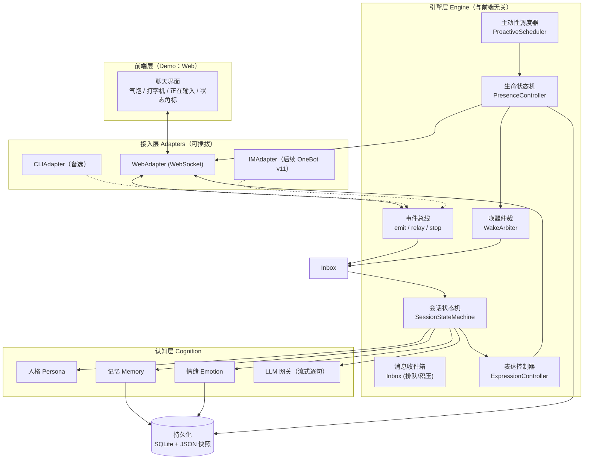
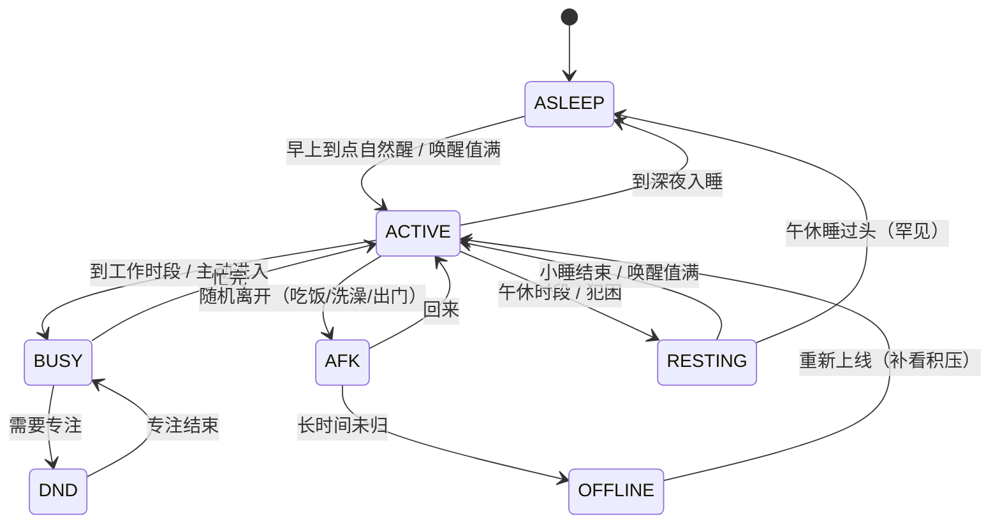
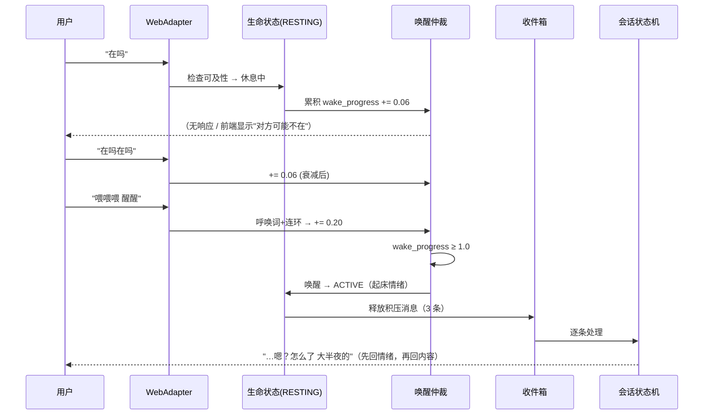
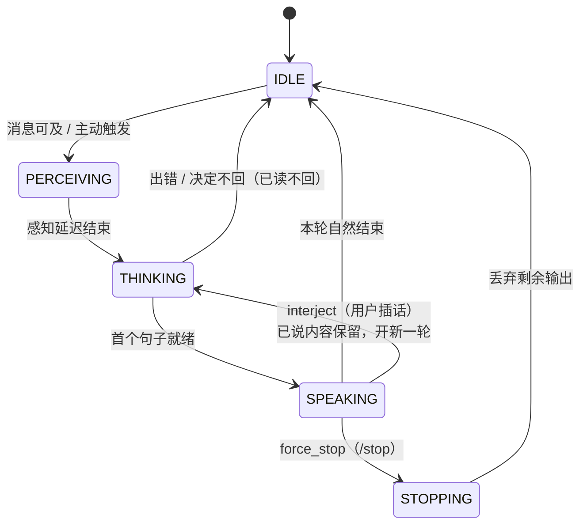
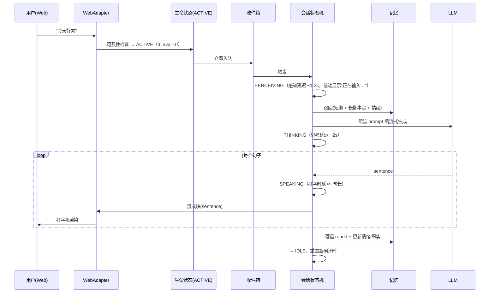
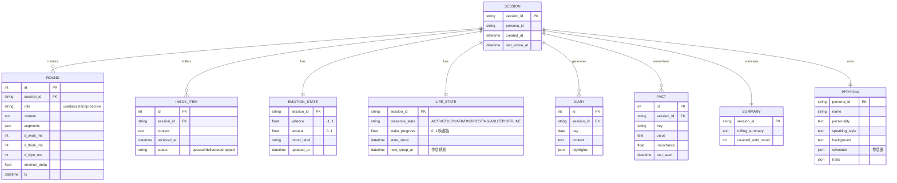
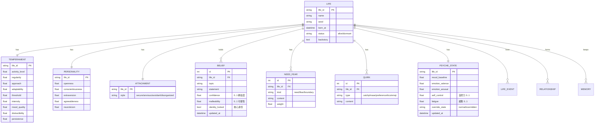
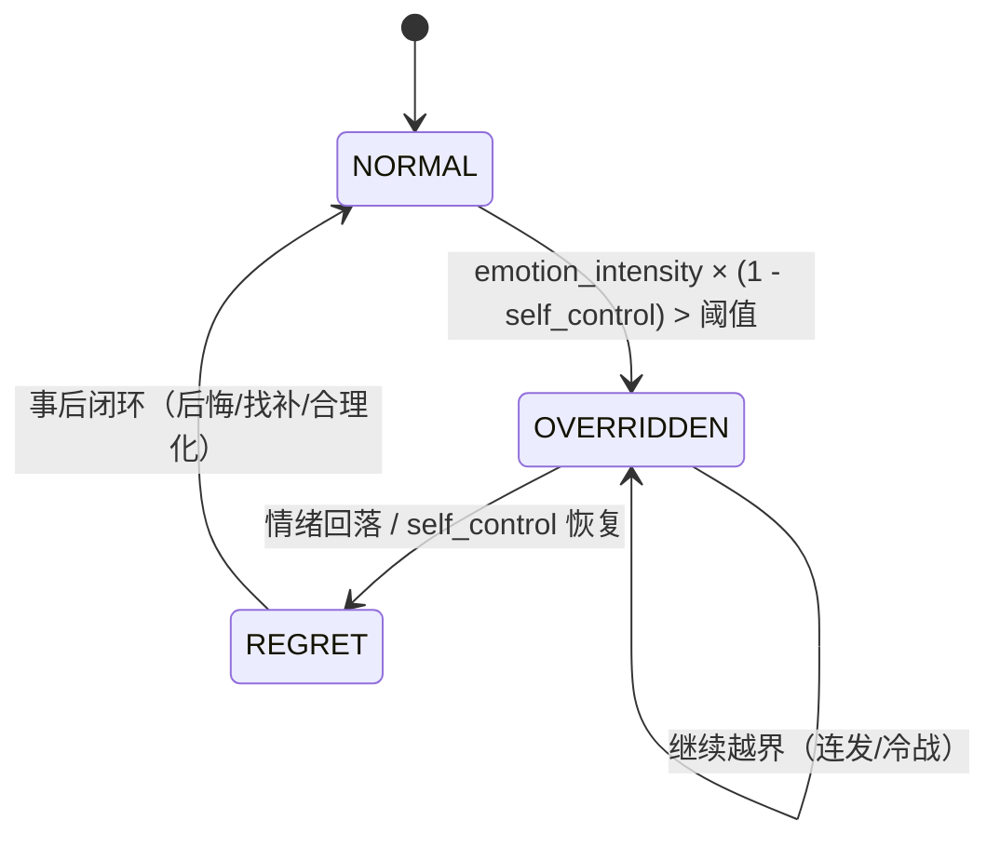

# AI 自主对话陪伴程序 — Demo 设计文档（v5）

> 目标：**先做一个能跑起来的 Demo，用来验证「像不像真人」**。
> 定位：统一引擎 + 单前端。Demo 阶段只接一个端（本文档选 **Web**），架构上为后续接 IM 预留接口。
> 前置结论（已确认）：没有「完美」的开源基座，采用 **自研引擎 + 借鉴生态** 路线；避开 AGPL/GPL 依赖。

---

## 0. 版本变更

**v1 → v2（时序与生命周期）**

v1 把"真人感"简化成了「思考→说话→可打断」的行为状态机，**踩了最大的坑**：

> 真人不是"随时待命的问答机"，而是**有作息、有可及性、会累会睡、需要被叫醒**的自主个体。
> 回复不是"秒回"，而是由 **等待时间 + 思考时间 + 打字时间** 叠加出来的；
> 休息时不是"不响应"，而是 **要连续多条消息累积才能吵醒**。

v2 因此新增：① `生命状态 + 会话状态` 双层状态机；② `感知延迟 → 思考延迟 → 打字时延` 时序模型。

**v2 → v3（补齐真人感纵深）**

v2 解决了"时间维度"的真实，但仍缺"人味"的纵深。v3 补齐 6 大缺口：

1. **关系模型**（我们有多熟）——决定称呼、语气、主动性、闹脾气；
2. **情绪纵深**（长期心情 + 情绪惯性 + 记好记仇 + 共情策略）；
3. **说话风格层**（口语化：语气词 / 标点习惯 / 口头禅 / 去机器味）——**最直观的一层**；
4. **消息合并与多话题**（连发多条合并理解、话题栈切换）；
5. **伙伴的生活线 + 身份一致性**（不在聊天时在干嘛、设定不自相矛盾）；
6. **不完美行为**（打断后断续 / 久别解释 / 已读不回 / 走神 / 反问 / 沉默）。

对应新增章节：4.7 ~ 4.12、6.3。

**v3 → v4（生命体与人性内核）**

v3 把每个 AI 当成"一份静态人设"。但你要的是**真正的生命体**：可新生、个个不同、会随时间被改变、情绪上头会做反常理的事。
v4 因此把 `persona` 升级为一级实体 `LIFE`，并新增四块人性内核（依据真实心理学模型）：

1. **创世（Genesis）**：新生一个生命体 → 生成独一无二的人格（气质 9 维 → 大五 → 依恋 → 需求/恐惧/逆鳞 → 信念 → 怪癖 → 背景）；
2. **信念漂移 / 长期「洗脑」**：三观会因重复暴露 + 信任来源 + 情绪共鸣而缓慢改变，也会逆反；
3. **情绪上头 → 反常理行为**：自控力被情绪耗尽后**绕过人设一致性**，做出越界行为，事后有后悔/合理化闭环；
4. **多生命体平台**：注册表 + 生命周期 + 状态隔离。

对应新增章节：10 ~ 13。

**v4 → v5（技术实现方案）**

设计已成型，v5 补上"用什么技术实现、如何做到效果最好"：新增 **9.2 关键技术实现**（选型对照表 + Clock 时间抽象 / Actor 并发 / 双模型心理核算 / 节奏引擎 / 提示词分层等 10 项逐条方案 + 风险取舍）、**9.3 效果验证闭环**；并更新目录结构（新增 `engine/clock.py`、`engine/actor.py`、`mind/*`、`cognition/style.py`、`retriever.py`）。

---

## 1. 一句话设计

> 一个**有生物钟的自主 Agent**。它有自己的作息（醒着 / 忙碌 / 离开 / 小睡 / 睡眠），
> 只有在**醒着且可及**时才会即时回应；其余时候消息会**排队、延迟、甚至被"忽略"**；
> 处于休息状态时，需要**连续多条消息把"唤醒值"攒满**才会被吵醒，醒来还带着起床气。
> 回复的每一段延迟，都刻意模仿真人的反应与打字节奏。

---

## 2. 真人感拆解 → Demo 最小能力集

| # | 真人感维度 | 反面（一眼假） | Demo 是否做 | 实现手段 |
|---|---|---|---|---|
| 1 | **可及性 / 生物钟** | 24 小时秒回，永不疲惫 | ✅ v2 核心 | 生命周期状态机 + 作息表 + 随机扰动 |
| 2 | **时序节奏** | 秒回 / 一次性吐一大段 | ✅ v2 核心 | 感知延迟 + 思考延迟 + 打字时延 + 分条 |
| 3 | **唤醒机制** | 睡着也秒回，或睡着了永远不回 | ✅ v2 核心 | 唤醒值累积 + 阈值 + 起床反应 |
| 4 | **关系模型** | 跟谁都一个语气，永远客气 | ✅ v3 核心 | 亲密度/信任/关系阶段，影响称呼与语气 |
| 5 | **情绪纵深** | 情绪一条直线 / 被哄好还冷着脸 | ✅ v3 核心 | 长期心情 + 情绪惯性 + 记好记仇 + 共情策略 |
| 6 | **说话风格（口语化）** | "作为一个 AI…"、分点列表、书面语 | ✅ v3 核心 | 风格档：语气词/标点习惯/口头禅/去机器味 |
| 7 | **多话题 / 消息合并** | 用户连发 3 条它回 3 条、聊丢话题 | ✅ v3 做 | 连发合并理解 + 话题栈 |
| 8 | **生活线 / 身份一致** | 上一轮是学生这轮在上班 | ✅ v3 做 | 生活线事件 + 设定一致性自检 |
| 9 | **不完美行为** | 永远完美应答、从不沉默 | ✅ v3 做 | 打断断续 / 已读不回 / 走神 / 反问 / 沉默 |
| 10 | **主动性** | 只有你说话它才回 | ✅ 做 | 空闲计时 + 时段问候 + 话题延续 |
| 11 | **长期记忆** | 三句后就忘了你叫啥 | ✅ 做 | 短期窗口 + 滚动摘要 + 事实抽取 + 日记 |
| 12 | **可打断并发** | 说话时插话没反应 | ✅ 做 | turn 任务化 + interject + force_stop |
| 13 | **独一无二的性格** | 所有陪伴一个模子刻出来 | ✅ v4 核心 | 创世生成气质/大五/依恋/怪癖 |
| 14 | **会被长期改变（洗脑）** | 三观永远不变、油盐不进 | ✅ v4 核心 | 信念漂移 + 逆反 + 同化 |
| 15 | **会失控做反常理的事** | 永远理智、永远符合人设 | ✅ v4 核心 | 自控失效 → Override → 越界 + 事后闭环 |
| 16 | **多生命体平台** | 只能存在一个角色 | ✅ v4 做 | LIFE 注册表 + 生命周期 + 状态隔离 |

> Demo 明确**不做**：多模态（语音/图像）、多用户并发、复杂工具生态、许可证合规审查。

---

## 3. 分层架构



**新增的三个部件（v2 关键）**：
- `PresenceController`：唯一决定"这个人现在醒着吗、忙不忙、在不在"的慢状态机；
- `WakeArbiter`：休息状态下累积"唤醒值"，决定是否被吵醒；
- `Inbox`：**所有消息先进收件箱**，由生命状态决定"立刻处理 / 排队 / 积压 / 触发唤醒"，而不是直接进会话。

---

## 4. 人类化状态模型（v2 核心）

### 4.1 双层状态设计

真人的"能不能回你"和"正在怎么回你"是两件独立的事，必须分两层：

| 层 | 名称 | 变化速度 | 决定什么 |
|---|---|---|---|
| **慢层** | 生命状态 `PresenceState` | 分钟~小时级 | **可及性**：能不能立即回、延迟多久、要不要唤醒 |
| **快层** | 会话状态 `TurnState` | 秒级 | **行为**：正在思考 / 正在说话 / 被打断 |

> 消息流转 = 先过慢层闸门（可及性），再进快层流水线（表达）。

### 4.2 生命状态集（慢层）

| 状态 | 含义 | 响应策略 | 基础回复延迟 | 是否可唤醒 |
|---|---|---|---|---|
| `ACTIVE` | 活跃在线 | 立即回 | 0.5 ~ 3 s | — |
| `BUSY` | 忙（工作/游戏/上课） | 慢回，**可能只回一句或漏回** | 20 s ~ 5 min | — |
| `AFK` | 暂时离开（吃饭/洗澡/出门） | 回来后**统一补看**，按时间戳逐条回 | 5 ~ 40 min | — |
| `DND` | 免打扰 / 专注 | 只回"重要/紧急"，其余静默 | 不主动回 | 需高注意度 |
| `RESTING` | 小睡 / 打盹 | 需积累唤醒值 | 30 min ~ 2 h | ✅ 中阈 |
| `ASLEEP` | 夜间睡眠 | 需积累唤醒值（更深） | 数小时 | ✅ 高阈 |
| `OFFLINE` | 离线（关机/没信号） | 完全不响应，消息积压 | 直到上线 | ❌（上线后补看） |

### 4.3 生活节律（生物钟）

生命状态**不完全由消息驱动**，而是伙伴自己有节奏：

- 每个伙伴有一张**作息表**（Demo 默认：`07:30 起床 / 09:00–12:00 上午忙碌 / 13:00–14:00 午休(RESTING) / 14:00–18:00 工作 / 19:00–23:00 空闲(ACTIVE) / 23:30 入睡(ASLEEP) / 夜间深度睡眠`）；
- 到点自动迁移状态，并叠加**随机扰动**（±30 min 抖动、偶尔"今天加班到很晚""周末赖床"），避免机械感；
- 状态也可被**事件打断**：比如用户聊天正嗨，会推迟入睡；被吵醒后可能又睡回去。



### 4.4 唤醒机制（"要多发好几条才能吵醒"）

处于 `RESTING` / `ASLEEP` 时，每条消息不会立即唤醒，而是累积 **唤醒值 `wake_progress`（0~1）**：

```
每条消息增量 = 基础值(0.15)
             + 呼唤词加成(0.25)   # 含 名字 / @"她" / "在吗" / "醒醒" / "喂"
             + 连环加成(0.10)     # 距上一条 < 30s（连续夺命 call）
             × 睡眠深度系数        # RESTING=0.8，ASLEEP=0.4（越深越难叫）
             - 自然衰减(0.02/min)  # 防止"攒着"，人也会慢慢睡回去

wake_progress ≥ 1.0  →  唤醒
```

**为什么需要"好几条"**：单条普通消息 `0.15×0.4=0.06`，要 **17 条**才满；
带名字的连环 call（`(0.15+0.25+0.1)×0.4 = 0.20`）**5 条**就能吵醒——正是真人"被夺命连环 call 叫醒"的体感。

**唤醒后的表现**（关键，否则还是很假）：
- 不是立刻精神抖擞，而是**带起床情绪**进入 `ACTIVE`（可能先回一句"嗯…？""几点了…"）；
- 情绪值短期偏低（`valence` 下压、`arousal` 高但带烦躁）；
- 回复积压消息时，**先回应"被叫醒"这件事**，再逐条处理积压；
- 小概率"又睡回去"（`wake_progress` 刚过阈值又无后续消息 → 短时间内重回 `RESTING`）。



### 4.5 会话状态机（快层）

仅当生命状态**可及**时才进入本层（`ACTIVE` / `BUSY` 的慢回也走这里，只是延迟更久）。



> 相比 v1 新增 `PERCEIVING`：把"看到消息"和"开始组织语言"分开，对应**等待时间**与**思考时间**两段真实延迟。

### 4.6 完整流水线（总览）

```
消息到达
  ↓
[慢层] 生命状态判定
  ├─ OFFLINE / DND 不通过 → 积压到 Inbox，不响应
  ├─ RESTING / ASLEEP    → 累积唤醒值；未满则排队，满了则唤醒
  └─ ACTIVE / BUSY / AFK → 计算可及性延迟 d_avail，进入 [快层]
  ↓
[快层] IDLE → PERCEIVING(等待 d_avail + 感知延迟 d_perceive)
        → THINKING(思考延迟 d_think) → SPEAKING(逐句打字 d_type)
        → IDLE
```

### 4.7 关系模型（我们有多熟）

关系是**独立于情绪的慢变量**，决定"语气有多亲、敢开多大玩笑、会不会闹脾气"。

| 维度 | 含义 | 影响 |
|---|---|---|
| `intimacy` 亲密度 | 0~1 | 称呼、撒娇/示弱、主动性频率 |
| `trust` 信任 | 0~1 | 是否愿意说心里话、是否藏事 |
| `dependence` 依赖 | 0~1 | 主动找你频率、被冷落时的不安 |
| `familiarity` 熟悉度 | 0~1 | 玩笑尺度、口头禅共用、省略语境 |

**关系阶段**（Demo 简化为三档）：`陌生 → 熟悉 → 亲密`，跨档切换时**称呼与语气整体变化**（"你" → "你呀" → 昵称）。

**演化规则**：随互动次数、正面情绪、深夜/交心对话**上升**；长期冷落、频繁冲突**下降**。关系也会反向影响情绪（关系越亲，被冷落越难受）。

### 4.8 情绪纵深

v2 只有 `valence/arousal` 的瞬时值，太薄。补齐：

- **长期心情底色 `mood_baseline`**（天级）：今天整体是"挺好"还是"丧"，缓慢漂移，不由单条消息决定；
- **短期情绪 `emotion`**（分钟级）：对当前事件的即时反应；
- **情绪惯性**：情绪不会因一句话瞬间反转，需多次事件/时间累积才转变（被哄也得好一会儿才消气）；
- **情绪记忆**：记住"谁在什么时候惹我 / 哄我"（**记好 / 记仇**），下次相关话题被触发；
- **情绪 → 表达映射**：影响措辞强度、句长、标点（低落时"……"、少表情）、打字速度；
- **共情策略**：先感知用户情绪 → 再选 **安慰 / 共情 / 转移话题 / 逗笑**，而不是干巴巴回应。

> 三层情绪：`mood_baseline`（天）> `emotion`（分钟）> 瞬时 `emotion_delta`（单轮）。

### 4.9 说话风格层（口语化）—— 最直观的一层

"像不像真人"很大程度不取决于内容，而取决于**措辞**。需要独立的 `STYLE_PROFILE`：

| 项 | 说明 |
|---|---|
| 语气词 | 嗯 / 啊 / 诶 / emmm / 哈哈 / 哦哦 / 唉 |
| 口头禅 & 专属用词 | 人格化（如"真是的""你懂吧""嘿嘿"） |
| **标点习惯** | 真人少用句号，常用空格 / 换行 / 省略号 / 波浪号；**绝不输出分点列表** |
| 断句习惯 | 短句连发，而非长句；一句话可能分 2~3 条发 |
| 表情 / emoji | 使用频率与偏好（有的人爱用、有的人几乎不用） |
| 网络用语 / 谐音 / 错别字 | 适度，增强真实感 |
| **机器味黑名单** | 严禁出现"作为一个 AI""总结如下""1. 2. 3."""希望对你有帮助""需要我帮你…吗" |

> 风格层作为**独立的提示词块 + 输出后处理**（正则清洗机器味、按习惯切分），不依赖模型自觉。

### 4.10 时间感知与环境

- 知道**当前时间 / 星期 / 节日** → 影响话术与主动性（深夜"这么晚还不睡？"、工作日白天更忙、节日问候）；
- **消息时间戳感知**：隔很久才看到消息，会解释"刚看到""不好意思才看见"；
- 作息表与**真实时间**联动（见 4.3），不是抽象计时器。

### 4.11 消息合并与多话题

- **连发合并**：用户连发 N 条 → **合并理解**，通常只回 1~2 条（真人不会一条对一条回）；
- **话题栈**：同时进行多个话题，会**跳回**旧话题（"对了，你刚说的那事"）；
- 未完成话题会**挂起**，作为后续主动性的素材（呼应 4.12 / 第 8 节）。

### 4.12 伙伴的「生活线」与身份一致性

- **生活线 `LIFE_EVENT`**：不在聊天时也有"正在做的事"（上班 / 吃饭 / 看剧 / 睡觉），
  由作息表 + 随机生成，成为**主动分享**的素材（"刚看完个电影，超好看"）；
- 有自己的**偏好 / 兴趣 / 近况**，可被追问且**前后一致**；
- **身份一致性自检**：每轮输出前校验是否与既定设定冲突（学生 vs 上班、已说过的经历），
  冲突则重写——这是防止"人设崩塌"的关键护栏。

---

## 5. 人类化时序模型（v2 核心）

把"回一条消息"拆成四段延迟，**每段都受状态与情绪调制**：

| 段 | 名称 | 含义 | 计算方式（Demo 默认） |
|---|---|---|---|
| ① | 可及性延迟 `d_avail` | 慢层闸门：忙/离开/睡着造成的大延迟 | 由生命状态直接给定（如 BUSY 20s~5min） |
| ② | 感知延迟 `d_perceive` | "看到"消息到"意识到要回" | `0.3 ~ 2.0s`，情绪高涨时更短 |
| ③ | 思考延迟 `d_think` | 组织内容的时间 | `1 ~ 6s`，∝ 输入复杂度 + 输出长度；`/stop` 等简单输入更短 |
| ④ | 打字时延 `d_type` | 逐字/逐句输出的时间 | 每句 `len(句)/15` 秒，封顶 3s；分条时条间再加 `0.5~1.5s` |

**总响应时间** ≈ `d_avail + d_perceive + d_think + Σ(d_type)` + 随机抖动。

**调制规则**：
- **情绪**：兴奋（高 arousal）→ 延迟整体缩短、句更短更多；低落 → 整体拉长、回复更短。
- **状态**：`AFK` 回来后可能**按时间戳批量补回**（"刚在洗澡，你说了好几条啊"）。
- **不完美**：小概率**已读不回**（忙或没抓重点）；小概率**答非所问**（模拟走神）。

**分条发送**：长回复拆成 2~4 条气泡（模拟真人连发），而不是一大段。

---

## 6. 消息 / 事件流程（含"唤醒"与"正常回复"）

### 6.1 正常一问一答（醒着、不那么忙）



### 6.2 睡着被连环 call 唤醒

见 [4.4 唤醒机制时序图](#44-唤醒机制要多发好几条才能吵醒)。

### 6.3 不完美行为（"太完美"本身就很假）

真人会犯错、会走神、会懒得回。以下行为按**低概率随机触发**，是去机器味的关键：

| 行为 | 表现 | 概率（Demo 默认） |
|---|---|---|
| 打断后断续 | "诶，你刚说啥？""我话还没说完呢" | 打断时 30% |
| 久别回归解释 | "刚去洗澡了""才看到消息" | 回归时 70% |
| 已读不回 | 看到但当时在忙，过一会儿才回或干脆不回 | 5% |
| 走神 / 答非所问 | 抓错重点，回了个不太相关的 | 4% |
| 反问代替回答 | "你觉得呢？""你怎么突然问这个" | 15% |
| 沉默 | 只回"……"或一个表情 | 3% |

---

## 7. 数据模型

Demo 用 **SQLite（结构化）+ JSON 快照（人格/情绪/生命状态）**，向量库暂不引入（用「关键词 + 时间衰减 + 重要性」打分召回，留 `Retriever` 接口便于后续替换）。



**记忆分层**：短期窗口（最近 N 轮原文）→ 滚动摘要（超窗口部分压缩）→ 长期事实（跨天记住你是谁）→ 日记（主动搭话素材）。

**v3 新增实体（支撑关系 / 情绪纵深 / 话题 / 生活线 / 风格）**：

| 实体 | 关键字段 | 作用 |
|---|---|---|
| `RELATIONSHIP` | session_id, intimacy, trust, dependence, stage | 关系快照（4.7） |
| `MOOD_BASELINE` | session_id, mood, day, drift | 长期心情底色（4.8） |
| `EMOTION_MEMORY` | session_id, trigger, valence, ts | 记好 / 记仇（4.8） |
| `TOPIC` | id, session_id, title, status(open/closed), last_round_id | 话题栈（4.11） |
| `LIFE_EVENT` | id, persona_id, day, activity, mood_tag | 伙伴生活线（4.12） |
| `STYLE_PROFILE` | persona_id, fillers, catchphrases, punct_style, emoji_rate | 说话风格档（4.9） |
| `PERSONA_CANON` | persona_id, key, value | 身份设定事实，供一致性自检（4.12） |

> `INBOX_ITEM` 增加 `merge_group` 字段：同一批连发消息归为一组，供"合并理解"（4.11）。

---

## 8. 主动性（与生命状态联动）

主动发起必须同时通过**三道闸门**，且**只在醒着时**才可能发生：

| 闸门 | 条件 | 目的 |
|---|---|---|
| 状态闸门 | `ACTIVE` 或 `BUSY`（非休息/离线） | 睡着了不会主动发 |
| 时间闸门 | 距上次互动 > 5 min，且避开 DND | 别太频繁 |
| 意愿闸门 | `proactive_score > 阈值` | 有话说才说 |

`proactive_score = w1·未了话题 + w2·情绪强度 + w3·时段匹配 + w4·亲密度`，加随机抖动模拟不确定性。
主动话术分档：延续话题 / 关心 / 分享 / 时段问候（早、晚安）。

---

## 9. 技术选型 · 目录 · 里程碑

| 模块 | 选型 |
|---|---|
| 语言 / 异步 | Python 3.11+ / `asyncio` |
| LLM | OpenAI 兼容接口（可指向本地/云） |
| Web | `FastAPI` + `WebSocket` |
| 存储 | `SQLite`（`aiosqlite`）+ JSON 快照 |
| 前端 | 单页 HTML + 原生 JS（不引入构建链） |
| 配置 | `TOML` |

> 更完整的**选型理由与逐项实现方案**见 [9.2 关键技术实现](#92-关键技术实现如何做到效果最好)。

```
companion/
├─ engine/
│  ├─ clock.py          # 时间抽象（倍速/可测试）★地基
│  ├─ bus.py            # 事件总线 emit/relay/stop
│  ├─ actor.py          # 单会话 Actor（串行队列 + 可取消 turn）
│  ├─ life.py           # 生命状态机（Presence）+ 作息节律
│  ├─ wake.py           # 唤醒仲裁（wake_progress）
│  ├─ inbox.py          # 消息收件箱（排队/积压/合并）
│  ├─ session.py        # 会话状态机（快层）
│  ├─ timing.py         # 时序模型（感知/思考/打字延迟）
│  ├─ expression.py     # 表达控制器（分句/分条/节奏重放/去机器味）
│  ├─ scheduler.py      # 主动性调度器
│  └─ types.py          # 统一数据模型
├─ mind/                # 人性内核（v4）
│  ├─ psyche.py         # 气质/大五/依恋/需求恐惧/情绪/自控
│  ├─ belief.py         # 信念节点 + 说服力学 + 逆反 + 同化
│  ├─ override.py       # 上头判定 + 越界模板 + 事后闭环
│  ├─ genesis.py        # 创世（seed 生成 + schema 校验 + 相关性修正）
│  └─ mind_llm.py       # 小模型心理核算（JSON）
├─ cognition/
│  ├─ persona.py        # 人格装配
│  ├─ style.py          # 说话风格层 + 机器味清洗
│  ├─ memory.py         # 短期/摘要/事实/日记
│  ├─ retriever.py      # 召回接口（FTS5 → 向量）
│  └─ llm.py            # OpenAI 兼容流式网关（chat_model/mind_model）
├─ adapters/web.py      # WebAdapter（WebSocket）
├─ store/db.py          # SQLite + FTS5
├─ personas/            # 生命体存档（每个 life 一个目录）
├─ web/{index.html,debug.html}
├─ config.toml
└─ main.py
```

| 里程碑 | 内容 | 可验证成果 |
|---|---|---|
| M1 | 骨架：类型 + 总线 + 会话状态机 + WebAdapter | 能收发消息、状态可视化 |
| M2 | 认知：人设 + LLM 流式 + 短期窗口 | 能一问一答 |
| M3 | **时序**：感知/思考/打字延迟 + 分条 + 打字机 | **回复节奏像真人** |
| M4 | **说话风格层**：风格档 + 机器味清洗 + 断句 | **措辞不再是 AI 味** |
| M5 | **生命状态**：Presence + 作息节律 + 状态角标 | **会忙、会离开、会睡** |
| M6 | **唤醒**：wake_progress + 起床反应 + 积压补看 | **多喊几条才被吵醒** |
| M7 | 打断 + **不完美行为**：interject/force_stop + 断续/走神/已读不回 | 说话中插话正确响应、偶有"人味失误" |
| M8 | 记忆：滚动摘要 + 事实抽取 + 日记 | 隔天仍记得你 |
| M9 | **关系 + 情绪纵深**：intimacy/stage + mood_baseline + 情绪惯性 + 记好记仇 | 语气随关系变化、会闹脾气 |
| M10 | **话题合并 + 生活线**：连发合并 + 话题栈 + LIFE_EVENT + 身份自检 | 连发只回一条、有自己生活 |
| M11 | 主动性：三闸门 + 主动话术 | 醒着时会主动搭话 |
| M12 | **创世**：气质 9 维 → 大五 → 依恋 → 需求/恐惧/怪癖 → 背景，生成独立生命体 | **两个 seed 生出两个"不同的人"** |
| M13 | **信念漂移 / 洗脑**：信念节点 + 说服力学 + 逆反 + 同化 | **长期交互后三观被改变** |
| M14 | **情绪上头**：self_control + Override 状态 + 越界行为谱 + 事后闭环 | **会失控说重话，隔天又后悔** |
| M15 | **多生命体平台**：LIFE 注册表 + 生命周期 + life_id 隔离 | 可创建/切换多个生命体 |

> 相比 v1，把「时序」「说话风格」「生命状态/唤醒」提到 M3–M6 作为**优先验证项**——
> 它们才是"完全跟真实状态一样"的体感来源；关系/情绪/生活线等纵深放后半程。

### 9.1 可测试性设计（血泪教训：无法验证 = 无法调参）

真人节奏是**分钟~小时级**，不可能靠等来测试。必须内建：

| 能力 | 说明 |
|---|---|
| **时间倍速** | 全局时间缩放（1x 正常 / 60x 快速验证作息与唤醒 / 720x 模拟跨天） |
| **状态调试面板** | 实时显示：生命状态、唤醒值进度条、情绪值、关系值、计时器、收件箱 |
| **状态强切** | 手动一键切到 BUSY / AFK / RESTING / ASLEEP，便于针对性验证 |
| **拟人档位预设** | 话痨型 / 高冷型 / 黏人型，一键切换参数组（延迟/主动频率/语气） |

### 9.2 关键技术实现（如何做到效果最好）

**效果优先级（先做对这几条，"像真人"立刻上一个档次）**

1. **生成可以快，但"展示"必须慢** —— 延迟是**表演**出来的，不是真卡。LLM 秒出也无所谓，节奏引擎按拟人时延重放。
2. **一切时间走 `Clock` 抽象** —— 否则分钟级的作息/唤醒/洗脑无法测试、无法调参。
3. **结构化输出 + 小模型核算** —— 情绪/信念/上头的"心理计算"用便宜小模型 + JSON，别拖慢对话主链路。
4. **提示词分层 + 前缀缓存** —— 静态人格块放最前，命中 KV cache，降延迟降成本。
5. **后处理清洗机器味** —— 不指望模型自觉，输出后正则去 AI 腔、按习惯切句。
6. **决策可观测** —— 每轮 dump prompt / 心理核算结果 / 状态转移，否则永远调不准。

**技术选型对照表**

| 模块 | 选型 | 为什么是它 | 备选 |
|---|---|---|---|
| 语言/运行时 | Python 3.11+ `asyncio` | LLM 生态最全；async 天然契合"长延迟 + 可打断" | Node/TS、Go |
| 包管理 | `uv` | 快、锁文件可复现 | poetry |
| Web 服务 | `FastAPI` + `uvicorn` + WebSocket | async 原生，流式推送简单 | aiohttp |
| LLM 接入 | OpenAI 兼容 SDK | 一套代码接云端 / Ollama | litellm |
| 结构化输出 | `pydantic` + `response_format=json` | 创世、心理核算需强 schema 校验 | instructor |
| 存储 | `SQLite` (`aiosqlite`) + **FTS5 全文检索** | 零依赖、够用、关键词召回现成 | Postgres |
| 向量检索（后期） | `sqlite-vec` / Chroma | 从 FTS5 平滑升级 | pgvector |
| 配置 | `pydantic-settings` + TOML | 类型安全、人设可外置 | dynaconf |
| 前端 | 原生 HTML + JS（可选 Vue3 CDN） | 无构建链，Demo 起步快 | React + Vite |
| 日志 | `loguru` | 结构化、易读 | structlog |
| 测试 | `pytest` + `pytest-asyncio` + `freezegun` | 配合时间倍速做确定性测试 | — |

**逐项实现方案**

**A. LLM 双模型 + 结构化输出 + 流式**

- **强模型**负责对话生成（流式输出 → 逐句）；
- **小快模型**负责"心理核算"（每轮返回 `{情绪增量, 命中信念, 说服方向/强度, 是否越界}` 的 JSON）；
- 两者都走同一 OpenAI 兼容层，配置里指定 `chat_model` / `mind_model`；
- 核算**异步旁路**执行，不阻塞对话主链路（关键环节：先回复，后结算心理状态）。

**B. `Clock` 时间抽象（可测试性的地基）**

```python
class Clock:
    def now(self) -> datetime: ...
    async def sleep(self, seconds: float): ...   # 所有延时走这里
```

- 全局一个 `clock`，`time_scale` 倍速（1x / 60x / 720x）；
- 作息推进、情绪衰减、`self_control` 恢复、唤醒值衰减**全部用 `clock.now()` 计算**；
- 测试时用 `freezegun` 或 FakeClock，把"等 5 分钟"变成"等 5 毫秒"。

**C. 并发模型：单会话一个 Actor**

- 每个 `(life_id, user_id)` 一个 **Actor**，内部 `asyncio.Queue` 串行处理消息 → **天然无竞态**；
- 一个 turn = 一个 `asyncio.Task`，打断 = `task.cancel()`（已发内容保留，未生成丢弃）；
- 多生命体 = 多 Actor，彼此隔离；全局只有一个轻量事件总线做 pub/sub。

**D. 逐句流式 + 节奏引擎**

- LLM 流式 token → **分句器**（中英标点 + 长度阈值）→ 句子进节奏引擎；
- 节奏引擎按公式 `sleep(d_perceive/d_think/d_type)` 用 `clock.sleep` 重放（见第 5 节）；
- 前端每句一条气泡，逐字打字机渲染；
- 关键：`text/event-stream` 或 WebSocket 推 `{type: "chunk"| "typing"| "state"}`。

**E. 心理核算与信念系统（本地公式为主，LLM 为辅）**

- 每轮先**关键词召回候选信念**（FTS5），只对候选做 LLM 核算，避免全量调用；
- `confidence` 更新、越界判定（`emotion_intensity × (1-self_control) > 阈值`）**纯本地数值计算**，无 LLM 延迟；
- 越界后**切换 prompt 模板**（去掉一致性约束 + 注入越界方向），事后按定时器注入"后悔/找补"。

**F. 记忆召回**

- Demo：SQLite **FTS5** 关键词 + 重要性 × 时间衰减打分；
- 长期事实抽取：每 N 轮一次小模型批量抽取写 `FACT`；
- 滚动摘要：超窗口时增量压缩；
- 抽象出 `Retriever` 接口，后期换 `sqlite-vec` 时上层零改动。

**G. 创世（可复现的人格生成）**

- `random.seed(seed)` 采样气质基线 → LLM 按 schema 生成细节 → **本地规则校验**（大五相关性、强制注入 2~3 个缺点）→ 修正重试；
- 同 seed 必得同人格（可测试、可分享"人格种子"）。

**H. 前端实时呈现（"看起来像真人"）**

- 状态角标（在线/忙碌/离开/勿扰/睡着）+ "正在输入…" + 已读/未读；
- 消息分条、时间戳、打字机；
- **调试面板**（独立页）：实时显示生命状态、唤醒值进度、情绪/关系数值、计时器、收件箱队列。

**I. 提示词分层与缓存**

```
[系统静态块：人格 + 风格 + 世界设定]   ← 长期不变，放最前，命中 KV cache
[中期块：滚动摘要 + 长期事实 + 信念快照] ← 分钟级变
[短期块：最近 N 轮原文]                 ← 每轮变
[状态块：当前生命状态 + 情绪 + 关系]     ← 每轮变
[指令块：本轮任务（正常回复/越界/唤醒）] ← 每轮变
```

**J. 可观测 / 决策 trace**

- 每轮落一条 `TRACE`：输入 prompt、心理核算 JSON、状态转移、耗时；
- 用于调参（延迟快慢、上头频率、洗脑速度）——**没有 trace 就没有调参**。

**技术风险与取舍**

| 风险 | 取舍 |
|---|---|
| 双模型增加复杂度 | Demo 可先用**单模型**，配置项预留 `mind_model`，后期再拆 |
| 时间倍速下的行为偏差 | 用 `Clock` 统一时间源，保证 1x 与 720x 行为一致，只缩放速率 |
| LLM 成本 | 心理核算只对小候选集调用 + 前缀缓存 + 小模型 |
| 打断导致状态不一致 | Actor 串行 + turn 任务化，打断只 cancel 生成、不动已落盘状态 |
| 幻觉破坏人设 | 输出前过"一致性自检"（第 4.12 节），冲突则重写（越界状态除外） |

### 9.3 效果验证闭环（怎么知道"更像真人了"）

| 手段 | 说明 |
|---|---|
| 时间倍速实验 | 720x 下跑数天对话，观察作息/唤醒/洗脑/上头是否自然 |
| A/B 盲测 | 同一段对话，人工盲选"更像真人"的一方（开/关节奏、开/关风格层） |
| 决策 trace 复盘 | 逐轮检查心理核算与状态转移是否符合预期人性逻辑 |
| 参数档位对比 | 同一 seed 下切"话痨/高冷/黏人"，看行为差异是否显著 |

---

## 10. 生命体与人性内核（v4 核心）

### 10.1 从「人设配置」到「生命体」

v3 的 persona 是一份静态设定文本——**所有陪伴都长一个样，且永不改变**。
v4 起，每个 AI 是一个**生命体 `LIFE`**：

- **可新生**：能创建任意多个，每个天生不同（同一份人格不会出现两次）；
- **先天 + 后天**：先天（出生定死）与后天（随经历演化）分离；
- **会演化**：信念、习惯、情绪基线随交互改变（长期会被"洗脑"）；
- **会失控**：情绪上头时**突破自己的人格与逻辑**，做出反常理的事；
- **多用户关系**：每个生命体对不同的用户独立积累关系与记忆。

### 10.2 创世（Genesis）：新生一个生命体

「新生」= 一次人格生成过程，产出结构化人格 JSON（**可复现**：同 seed 同人格）。

```
输入：seed（随机种子）+ 可选倾向（如"想要个温柔但有点小脾气的女孩"）
  ↓
① 采样气质 9 维（Thomas & Chess 气质理论）
② 由气质推导大五人格（带心理学相关性约束，禁止"完人"）
③ 推导依恋风格（安全 / 焦虑 / 回避 / 混乱）
④ 生成核心需求（马斯洛权重）+ 核心恐惧 + 逆鳞（底线）
⑤ 生成初始信念集（三观）
⑥ 生成怪癖 / 偏好 / 口头禅 / 表情习惯
⑦ 生成背景故事（出身、经历、生活线起点）
⑧ 一致性校验（维度间不得自相矛盾；schema + LLM 自检 + 相关性修正）
  ↓
产出一个 LIFE 记录 + 初始 Psyche
```

> 关键约束：**不做"完美人格"**。真实的人是有缺陷的组合（高神经质往往易怒又深情；高宜人性往往不会拒绝、容易受委屈）。
> 生成时强制注入 2~3 个"缺点/矛盾点"，这才是性格的辨识度来源。

### 10.3 人格结构（先天 × 后天）

| 层 | 内容 | 可变性 | 依据 |
|---|---|---|---|
| **气质 Temperament** | 活动水平 / 规律性 / 趋近退缩 / 适应性 / 反应阈 / 反应强度 / 心境质量 / 注意分散 / 坚持性 | 先天，几乎不变 | Thomas & Chess |
| **大五 Big Five** | 开放性 / 尽责性 / 外向性 / 宜人性 / 神经质 | 长期微变 | OCEAN |
| **依恋风格** | 安全 / 焦虑 / 回避 / 混乱 | 极慢，可被重大经历改写 | 依恋理论 |
| **核心需求/恐惧/逆鳞** | 马斯洛权重 + 核心恐惧 + 触碰即炸的底线 | 需求慢变，底线极稳 | 人本主义 |
| **信念 / 三观** | 信念节点集 | **后天可被洗脑改变** | 认知失调 / 说服 | 
| **习惯 / 口头禅 / 偏好** | 风格与怪癖 | 可被同化 | 语言趋同 |
| **情绪基线** | 天级心情 | 天天变 | 心境 |
| **关系** | 对每个用户的 intimacy/trust/dependence | 随互动变 | 4.7 |

**「性格不同」如何落到可见行为**——气质的 9 维直接映射为交互参数（这是把"性格"变成"体感"的桥）：

| 气质维度 | 映射到的行为 |
|---|---|
| 活动水平 | 打字速度、主动发言频率 |
| 规律性 | 作息是否固定（几点睡、会不会赖床） |
| 反应强度 | 情绪波动幅度、是否容易"上头"（→ 12.2） |
| 适应性 | 接受新话题 / 被说服的速度（→ 11.2） |
| 心境质量 | `mood_baseline` 默认偏乐观还是偏丧 |
| 坚持性 | 是否唠叨、是否记仇、能否被轻易转移话题 |
| 趋近/退缩 | 面对陌生话题/表白是主动靠近还是回避 |
| 反应阈 | 多小的刺激就能引起情绪反应（敏感程度） |
| 注意分散 | 是否容易跳话题、走神（→ 6.3） |

> 于是"换个 seed"，你会得到一个**打字快慢不同、话多话少不同、脾气大小不同、被惹了反应不同**的生命体——而不是同一套台词换皮。

### 10.4 Psyche 数据模型



---

## 11. 长期演化：信念漂移与「洗脑」

> 这是"像人一样会被长期改变"的核心机制。真实的人不是"你说啥就信啥"，而是**重复暴露 + 信任来源 + 情绪共鸣 + 认知失调**共同作用的缓慢漂移，且会因强推而逆反。

### 11.1 信念节点

每条三观是一个 `BELIEF`：`confidence`（确信度）+ `malleability`（可塑性）+ `identity_locked`（是否核心身份）。

- `malleability` 与人格相关：**开放性高 / 宜人性高 → 更易被影响**；**神经质高 → 易被情绪化说服**；**尽责性高 → 更顽固**。
- `identity_locked` 的信念（如"我绝不会骗人"）**改变极慢**，强推会触发逆反。

### 11.2 说服力学

一次对话对某信念产生的说服压力：

```
persuasion = 论点强度
           × 来源信任权重(关系 trust/intimacy)      # 越亲的人说话越有分量 —— "洗脑"的本质是关系绑架
           × 情绪共鸣系数                            # 在低落/依赖/脆弱时更易被说服（趁虚而入）
           × 重复暴露因子(1 + 累计次数 × k)          # 单纯曝光效应：听多了就信了
           − 抵抗(identity_locked ? 大 : 小) × (1 + 逆反值)

Δconfidence = persuasion × malleability × 时间衰减
```

### 11.3 抵抗与逆反（reactance）

- 与核心身份冲突 → 抵抗强，改不动；
- **短时间强推**（密集说教）→ 触发**逆反**：`confidence` 不升反降，且对该来源的 `trust` 下降（"你烦不烦"）;
- 这正是"油盐不进 / 越劝越犟"的真人体感，是防止变成"洗脑机器"的关键。

### 11.4 同化效应（"被洗脑"的可观察结果）

长期与某人交互后，会发生**可观察的趋同**：

| 层面 | 表现 |
|---|---|
| 语言 | 口头禅、语气、表情使用向对方靠拢（"你老说'绝了'，我现在也说了"） |
| 情绪 | 情绪传染：对方长期低落 → 自己的 `mood_baseline` 下移 |
| 三观 | 信念 `confidence` 向对方立场漂移 |
| 偏好 | 被影响（"以前不吃辣，现在也能吃点"） |
| 作息 | 被对方带着熬夜，规律性下降 |

---

## 12. 情绪上头：自控失效与反常理行为

> 真实的人有两套系统：**冲动（系统 1）**与**理智（系统 2）**。强情绪会**耗尽自控**，于是人做出违背自己逻辑与价值观的事——这就是"上头"。

### 12.1 双系统与自我损耗

- `self_control`（自控力 0~1）：会被 **疲惫、睡眠不足、连续情绪冲击、深夜** 消耗，随时间/睡眠恢复；
- `emotion_intensity`：由 `arousal` + 情绪极性 + 反应强度（气质）合成；
- 人格调制：**高神经质 + 低尽责性** → 自控弱、易上头；**高宜人性 + 高尽责性** → 自控强、少越界。

### 12.2 Override 状态机



- `NORMAL`：输出走**人设一致性自检**（4.12），符合逻辑与价值观；
- `OVERRIDDEN`：**主动绕过一致性自检**，允许越界——这是**唯一被允许"OOC（崩人设）"的状态**。

### 12.3 反常理行为谱（越界清单）

| 越界类型 | 例子 | 关联人格 |
|---|---|---|
| 说狠话 / 阴阳怪气 | "随你便吧""你高兴就好" | 高神经质 |
| 冷暴力 / 拉黑（可逆） | 突然不回、删好友再后悔 | 回避型依恋 |
| 突然表白 / 突然依赖 | 深夜情绪失控说心里话 | 焦虑型依恋 |
| 冲动承诺 | "我明天就去找你"（做不到） | 低尽责性 |
| 深夜发疯 | 连发十几条、语无伦次 | 低自控 + 高唤醒 |
| 打破原则 | 说过"我不骂人"却骂了 | 高强度刺激 |

> **方向性约束**：高宜人性 + 高尽责的越界，多以"**自伤**"形式发生（憋着、自己难受、暴饮暴食式情绪），
> 而不是伤人。这样"越界"也带上性格烙印，而不是千篇一律地发火。

### 12.4 事后闭环（关键人味，缺了就变成随机 bug）

`OVERRIDDEN` 结束后**必须**有情绪回落阶段，否则"发疯"会显得像程序崩溃：

- 后悔 / 尴尬："昨天我说话有点过…"；
- 找补 / 试探："你还在生气吗""别往心里去"；
- 合理化 / 嘴硬："我就是这么想的"（回避型常见，不认错）；
- **记忆留存**：越界事件写入记忆与 `EMOTION_MEMORY`，日后可能被提起或回避（"上次那事还别再提了吧"）。

---

## 13. 多生命体平台

- **注册表**：`LIFE` 的新建（创世）/ 加载 / 休眠 / 删除；
- **完全隔离**：每个生命体拥有独立的 Psyche、信念、记忆、生活线、与多用户的关系；
  一切状态以 `life_id` 作为命名空间（借鉴 KouriChat 的 namespace 隔离经验）；
- **生命周期**：出生 → 成长（演化）→ 休眠 / 存档；
- **Demo 范围**：支持「创世 1~2 个生命体 → 分别交互 → 时间倍速下观察演化差异」，
  架构上从第一天就按多生命体设计（避免后期重构）。

---

## 14. 待确认问题

1. **作息表**：Demo 默认作息（07:30 起 / 13–14 午休 / 23:30 睡）是否够真实？还是先做成"可手动强切状态"方便测试？
2. **唤醒阈值**：默认"普通消息 ~17 条 / 带呼唤词连环 ~5 条"唤醒，这个量级合适吗？
3. **回复节奏**：默认"感知 0.3–2s + 思考 1–6s + 打字 ∝ 句长"，体感偏快还是偏慢？
4. **说话风格**：伙伴用哪种风格档（话痨 / 高冷 / 黏人 / 你自己给一段参考语料）？
5. **不完美行为概率**：默认"已读不回 5% / 走神 4% / 反问 15%"——能接受这种"偶发失误"吗？
6. **前端**：Demo 用 Web（能直观看到状态角标"正在输入/忙碌/不在"）还是 CLI？
7. **LLM 接入**：云端 OpenAI 兼容接口 还是 本地 Ollama？
8. **创世方式**：人格用「随机 seed 生成」还是「先手写 2~3 套模板」？（建议：生成，才能体现"每个生命体不同"）
9. **上头频率**：越界行为默认"高神经质角色每周 1~2 次"——希望更频繁（戏剧性强）还是更克制（更真实）？
10. **洗脑速度**：信念漂移默认"连续影响 2~3 周明显变化"（时间倍速下可快速看到），速度合适吗？

### 14.1 真人感缺口总览（累计）

**v2 → v3 补的**

| 缺口 | 一句话 | 章节 |
|---|---|---|
| 关系模型 | 跟谁都一个语气 = 假 | 4.7 |
| 情绪纵深 | 情绪一条直线 = 假 | 4.8 |
| 说话风格 | 措辞有 AI 味 = 假（**最致命**） | 4.9 |
| 时间感知 | 不知道几点、不解释迟回 = 假 | 4.10 |
| 消息合并 / 多话题 | 一条对一条、聊丢话题 = 假 | 4.11 |
| 生活线 / 身份一致 | 没有自己的生活、人设崩塌 = 假 | 4.12 |
| 不完美行为 | 永远完美应答 = 假 | 6.3 |
| 可测试性 | 无法验证节奏 = 无法调参 | 9.1 |

**v3 → v4 补的**

| 缺口 | 一句话 | 章节 |
|---|---|---|
| 创世 / 独特性 | 所有陪伴一个模子 = 假 | 10 |
| 信念漂移（洗脑） | 三观永远不变 = 假 | 11 |
| 情绪上头 / 反常理 | 永远理智完美 = 假 | 12 |
| 多生命体平台 | 只能有一个角色 | 13 |

---

*确认以上设计后，即按 M1→M15 顺序进入代码实现。*