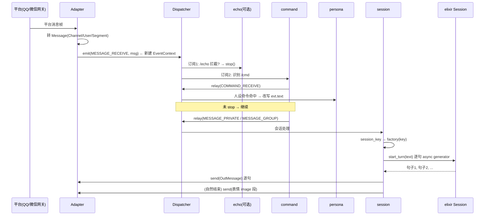
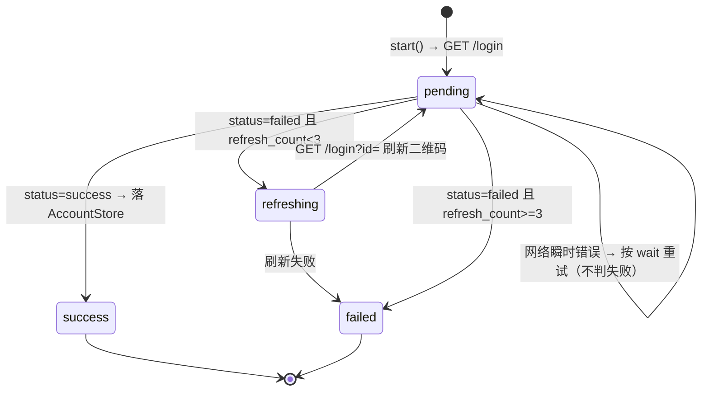

# KouriChat 1.5.0.1 架构分析与独立开发指南

> 目的：完整拆解 KouriChat 1.5 的实现方式，提炼可复用的工程知识点，并给出「自己独立开发一款同类产品」的落地路线与自研替换方案。
>
> 分析对象：`c:\Users\86153\Desktop\KouriChat-1.5.0.1`，代码量约 Python 180 KB + Vue 前端 60 KB。
>
> 版本：1.5.0.1（重构·开发版）

---

## 目录

1. [项目定位与技术栈](#1-项目定位与技术栈)
2. [总体架构](#2-总体架构)
3. [核心机制详解](#3-核心机制详解)
4. [关键数据模型与状态机](#4-关键数据模型与状态机)
5. [配置系统（TOML）](#5-配置系统toml)
6. [打包与部署](#6-打包与部署)
7. [可复用工程知识点清单](#7-可复用工程知识点清单)
8. [独立开发的差距分析与自研方案](#8-独立开发的差距分析与自研方案)
9. [风险与已知坑](#9-风险与已知坑)

---

## 1. 项目定位与技术栈

### 1.1 产品定位

一个**接入 QQ / 微信的 AI 角色扮演聊天机器人**：

- 通过 OneBot v11 协议接入 QQ（NapCat / Lagrange 等网关），通过 OpenClaw（weixin-gateway）接入微信；
- 以「人设（persona）」驱动大模型进行沉浸式角色扮演，支持群聊、消息分段、表情包、持久化长期记忆；
- 提供可视化 WebUI 控制台（扫码登录 / 账号管理 / 聊天调试 / 日志 / 配置编辑）。

### 1.2 技术栈

| 层次 | 技术 | 说明 |
|---|---|---|
| 运行时 | Python ≥ 3.14 | `pyproject.toml` 限定 `requires-python = ">=3.14"` |
| 插件内核 | `cordis-python` ≥ 0.9.2（第三方） | 提供 `Context` / `ctx.plugin` / `ctx.provide` / `ctx.get` / 拓扑排序 / `dispose_all` |
| LLM 引擎 | `elixir` 0.1.0（**私有闭源 wheel**） | 提供 `Session` 双核引擎、`Store`、`Memory`、`Tool`、`OpenAIProvider` 等 |
| 日志 | `loguru` | 自研 `LoguruLogger` 适配层 |
| Web 服务 | `aiohttp` | WebUI 静态托管 + JSON API |
| WS | `websockets` | OneBot / OpenClaw 适配器 |
| 前端 | Vue 3 + TypeScript + Vite 7 + Tailwind CSS 4 + d3 + qrcode | 单页控制台，无路由库 |

**关键结论**：框架自身（`kourichat`）只做**装配与协议适配**，真正的重活（对话引擎、记忆、工具调用）全部在闭源的 `elixir` 里。这一点决定了自研时的核心工作量。

### 1.3 部署形态

单进程、常驻事件循环：

```
kourichat run
 ├─ 读 kourichat.toml
 ├─ 初始化日志（loguru）
 ├─ 建 Context，注入 config/logger/events/stop_event
 ├─ 按清单顺序装配插件（adapters → plugins）
 ├─ await stop_event（SIGINT/SIGTERM/EOF 触发）
 └─ dispose_all 反序卸载
```

WebUI 默认 `127.0.0.1:8080`（**无鉴权，禁止公网暴露**）。

---

## 2. 总体架构

### 2.1 分层

```
┌───────────────────────────────────────────────────────────────┐
│ WebUI 控制台 (kourichat.webui, aiohttp + Vue SPA)             │
│   /api/openclaw/*  /api/chat/*  /api/logs  /api/settings ...  │
└───────────────▲───────────────────────────────┬───────────────┘
                │ 读服务/热更新                 │ 注入假消息
┌───────────────┴───────────────────────────────▼───────────────┐
│ 事件层 (kourichat.event)                                       │
│  Dispatcher: emit / relay / dispatch（串行 + stop 截断）       │
│  EventContext: text/segments/sender/channel/state 可修饰      │
└──────▲────────────────────────────────────────────────────────┘
       │ MESSAGE_RECEIVE                        出向 adapter.send
┌──────┴──────────────┐        ┌─────────────────────────────────┐
│ 接入层 (adapter/*)  │        │ 逻辑层 (logic/*)                │
│  base.Adapter ABC   │        │  echo → command → persona →     │
│  cli / onebot /     │        │  session                        │
│  openclaw           │        └──────────────▲──────────────────┘
└─────────────────────┘                       │ llm.factory(key)
                                   ┌──────────┴──────────────────┐
                                   │ LLM 层 (llm/*)              │
                                   │  factory: key → elixir      │
                                   │  Session                    │
                                   │  memory: Emotion/LongTerm/  │
                                   │  Diary                      │
                                   │  expressions: 表情工具       │
                                   └──────────▲──────────────────┘
                                              │ 复用
                                   ┌──────────┴──────────────────┐
                                   │ elixir（闭源引擎）           │
                                   │ Session/Store/Memory/Tool/  │
                                   │ OpenAIProvider/Settings     │
                                   └─────────────────────────────┘
```

### 2.2 插件模型

每个插件是一个模块，暴露：

```python
async def apply(ctx, config) -> dispose_callable | None
```

- 由 `core.load_plugin()` 用 `importlib.import_module(module)` 动态导入，取 `apply`，通过 `ctx.plugin(apply, config)` 挂载，并 `await fiber` 等待加载完成；
- 返回的 `dispose` 用于卸载（注销事件订阅、取消后台任务、关闭连接/Store）；
- **装配顺序 = 事件订阅顺序 = 配置清单顺序**：`adapters()` 先于 `plugins()`；同插件内按装饰器出现顺序。

### 2.3 事件链（核心业务流）



---

## 3. 核心机制详解

### 3.1 事件系统（`kourichat/event/`）

**事件常量**（字符串，见 `event/__init__.py`）：

| 常量 | 值 | 触发者 |
|---|---|---|
| `MESSAGE_RECEIVE` | `message.receive` | adapter 入向，**唯一入口** |
| `COMMAND_RECEIVE` | `command.receive` | command 插件 relay，**按命令名/别名筛选订阅** |
| `MESSAGE_PRIVATE` / `MESSAGE_GROUP` | `message.private/group` | command 插件按类型续发 |
| `NOTICE_RECEIVE` / `REQUEST_RECEIVE` | `notice.receive` / `request.receive` | 平台通知/请求（预留，openclaw notice 使用） |

**Dispatcher 三个方法语义**（`event/dispatcher.py`）：

- `emit(event, message)`：**起新链**，新建 `EventContext`；
- `relay(ctx, event)`：**复用同一 ctx** 续发下一级事件（上下文修饰贯通全链）；
- `dispatch(ctx, event)`：**串行**执行所有匹配订阅，返回是否执行了处理器。

两个关键设计：

1. **`stop()` 截断**：任一处理器调 `ctx.stop()`，本事件级与后续订阅全部跳过。echo 插件靠它拦截消息。
2. **`COMMAND_RECEIVE` 特例**：只执行 `command` 名或 `aliases` 匹配的订阅（`dispatch` 内筛选），避免所有命令处理器都被唤起。

**装饰器订阅 API**（`event/decorator.py`）：

```python
@on_message()                       # 默认 MESSAGE_RECEIVE
async def decorate(ctx: EventContext) -> None: ...

@on_command("help", aliases=("h",))
async def help_cmd(ctx: EventContext) -> None: ...

async def apply(ctx, config):
    return register_module_handlers(ctx, locals())   # 扫描带标记函数统一注册，返回 dispose
```

- 装饰器**只标记**（写 `__kouri_events__`），注册交给 `register_module_handlers`；因此插件 `apply` 用 `locals()` / `globals()` 一把注册，卸载时统一注销（插件级注册表）。

**EventContext**（`event/context.py`）：

- 可写：`text` / `segments` / `sender` / `channel` / `state`（前置修饰器加工上下文）；
- 只读：`event_name` / `message` / `raw`（原始事实）；`segments` 是**深拷贝**，改 ctx 不污染 message；
- `state` 是任意字典，用于跨级传参（如 `state["command"]`、`state["args"]`）；
- `stopped` 只能由 `stop()` 置位；`event_name` 由调度器在派发期维护，结束还原。

### 3.2 统一数据模型（`kourichat/types.py`）

与 OneBot v11 段模型**同构**，这是接入层可插拔的关键：

```python
Channel(platform, channel_id, channel_type)   # channel_type: group|private|channel
User(user_id, name)
Segment(type, data)                            # type: text|image|at|face|record|video|reply...
Message(id, channel, sender, segments, ts, raw)
OutMessage(channel, segments)
text_of(segments) -> str                       # 拼接 text 段
```

### 3.3 命令路由（`logic/command.py`）

- 监听 `MESSAGE_RECEIVE`，文本以 `prefix`（默认 `/`）开头 → `shlex.split` 解析 → 写 `state["command"]/["args"]` → `relay(COMMAND_RECEIVE)`；
- 引号畸形时 `parts=[]`，按普通消息透发（**不杀死 adapter 读循环**）；
- **未 `stop()`** → 按 `channel_type` 续发 `MESSAGE_GROUP` / `MESSAGE_PRIVATE`。

> 设计要点：命令与对话**共用同一条链**，命令处理器可以「只修饰不截断」，从而让人设命令 `/问候` 自然变成一轮对话。

### 3.4 人设系统（`persona.py` + `logic/persona.py`）

人设 = 一个 `.krp` 目录（不打包，MVP 直接读目录）：

```
<id>.krp/
    index.toml        # name / intro / [[commands]]{name, prompt}
    heart.prompt      # 心核人设文本（可选）
    reason.prompt     # 智核人设文本（可选）
    expressions/      # 表情包
        index.json    # [{"id","path","description"}]
        <图片>
    tools/            # *.py，继承 elixir Tool 且可无参实例化的类，逐个注册
```

- `scan_personas()` 扫描目录 → `{persona_id: Persona}`；**单个 .krp 损坏只跳过该人设**，不拖垮注册表；
- `logic/persona.py` 提供两个服务：`persona.registry`（全部）、`persona.active`（当前启用，config `enable` 指定，缺省取第一个）；
- 人设命令通过 `dispatcher.subscribe(COMMAND_RECEIVE, handler, command=name)` 注册；处理器把「命令 prompt + 用户输入」拼成本轮对话文本（**不 stop**，自然续发到会话处理）。

### 3.5 会话处理（`logic/session.py`）—— 最精巧的一环

**会话 key 收敛规则**：

```python
group   -> f"{platform}:group:{channel_id}"
private -> f"{platform}:private:{channel_id}:{user_id}"
```

**turn 任务化（非阻塞）**：消息到达时**不阻塞事件链**，而是 `asyncio.create_task(_drive(...))` 后台跑 `session.start_turn(text)`，逐句 `adapter.send`。这样机器人说话期间适配器仍能收新消息。

**打断（interject）**：session 忙时新消息：

| 场景 | 行为 |
|---|---|
| `active` 且有 `interject` | 调 `session.interject(text)`（合成中切流、加话起新一轮） |
| `active` 但无打断接口（替身对象） | 丢弃并告警（防 `ActiveTurnError`） |
| 忙但 turn 尚未 `active`（启动窗口） | **排队**，本任务结束后补跑 |
| 文本 == `stop_word`（`/stop`） | `session.force_stop()`（已说的话保留，未合成丢弃） |

**表情 holder 机制**：人设 `send_expression` 工具把选中的表情写入 `session._kouri_expr` holder；**仅当整轮自然结束**才补发 `image` 段；期间被打断/强断 → 清空 holder（本轮表情作废）。

**dispose 干净**：注销订阅 + 取消所有在跑 turn 任务 + 清空 pending，保证 shutdown 无残留协程。

### 3.6 LLM 层（`llm/factory.py`）—— 把 elixir 装配进框架

工厂插件只做「key → elixir Session」，不定义新的 LLM 抽象：

```python
def get_session(key):
    persona = ctx.get("persona.active")
    skey = f"{key}|{persona.id}" if persona else key     # 人设隔离记忆命名空间
    session = new_session(
        skey,
        settings=_compose_overrides(persona, settings),  # 人设文本 + elixir 内置操作规则
        data_source=JsonlDataSource(data_dir),
        llm=provider,                                     # OpenAIProvider
        logger=logger,
        memories=[], tools=[],                            # 先留空，再注入
    )
    session.memories = [LongTermMemory(...), EmotionMemory(...), DiaryMemory(...)]
    session.tools = persona.tools + [ExpressionListTool, ExpressionSendTool]
    session._kouri_expr = holder
    session._check_duplicates()                          # 工具名冲突检测
```

要点：

- **人设 prompt 与 elixir 内置规则合并**：`persona.heart_prompt + heart_role_prompt(settings)`，避免风格与操作规则耦合；
- **长期摘要用隔离 Store**：`data_dir/summaries` 独立目录 + 共享一个 Store 实例，全会话复用；
- **热重载**：WebUI 保存 LLM 配置时，`dispose` 旧 fiber → 用新配置重新 `ctx.plugin(apply, cfg)`，会话记忆经 Store 从磁盘恢复不丢。

### 3.7 记忆系统（`llm/memory.py`）—— 三个记忆器

实现 elixir `Memory` ABC，钩子：`on_round_completed(session)` / `boot_context()` / `function_pack(role)` / `run_tool(name, role, **kwargs)`。

| 记忆器 | 定位 | 工具 | 落盘时机 |
|---|---|---|---|
| `EmotionMemory` | 情绪变更**流水日志**（关键词/值0-10/原因/日期/轮id） | `note_emotion`(仅 heart)、`emotion_latest`、`emotion_older` | 轮内首次调用记 pending，轮完成写 Store |
| `LongTermMemory` | **K/M 窗口压缩** + 摘要检索 + 原文回溯 | `summary_search`、`view_rounds`、`search_rounds`、`round_window` | 未归档轮 ≥ M 时触发压缩 |
| `DiaryMemory` | AI 自主写入「绝不遗忘」的关键事实，只追加 | `diary_write`、`diary_read` | **即写**（不依赖轮完成钩子） |

**LongTermMemory 压缩算法**（核心）：

```
count = Live 未归档轮数
if count >= max_count(M) and count > keep_count(K):
    evict = 最老的 (count - K) 轮
    entry = 用「概要人设」把 evict 压成一段 narrative（携带覆盖的 round_ids）
    写 summary Store（隔离文件）
    Live 上下文 drop 掉 evict（原文仍在主 store，可 view_rounds 回溯）
```

> 知识点：**原文永不删除**，只在 LLM 上下文窗口里「折叠」成摘要；摘要携带 `round_ids` 使 AI 能按需 `view_rounds` 取回原文。这是「有限上下文 + 无限记忆」的经典解法。

**DiaryMemory 的即写契约**：`diary_write` 直接 `store.append`（进内存，随定时 flush 落盘），不依赖轮完成钩子 → 即使该轮被强断/出错，已确认写入的日记也不丢。

### 3.8 适配器层（`adapter/`）

**基类契约**（`adapter/base.py`）：

```python
class Adapter(ABC):
    capabilities: frozenset[str] = frozenset()
    async def send(self, out: OutMessage) -> str: ...   # 返回平台 message_id
    async def recall(self, msg_id: str) -> None: ...
    async def close(self) -> None: ...
```

入向由各实现自建，收到消息统一 `events.emit(MESSAGE_RECEIVE, msg)`；**类型级事件由逻辑层 relay，适配器不重复发**（避免重复处理）。

#### OneBot v11 适配器（`adapter/onebot.py`）

支持两种形态（config `mode`）：

| 形态 | 机器人的角色 | 配置 | 典型场景 |
|---|---|---|---|
| `forward` | WS **客户端** | `ws_url` + `token` | 主动连 NapCat 正向 WS |
| `reverse` | WS **服务端** | `ws_host`/`ws_port` + `token` | NapCat「反向 ws」连入本机 6700 |

关键技术点：

- **echo 动作匹配**：每帧带自增 `echo`，`send` 时 `create_future` 存入 `_pending[echo]`，收到带同 `echo` 的响应帧即 `set_result`，实现「请求-响应」同步语义（超时 10s）；
- **发送锁**：多会话并发回复共用同一连接 → `_send_lock` 串行化帧写入；
- **register 段过滤**：config `register=["text","image"]` 声明支持的段类型，不支持的段直接丢弃，过滤后为空则整条消息忽略；
- **reverse 鉴权**：校验 `Authorization: Bearer <token>`，失败 `close(4001)`；
- **清理**：`close()` 取消读任务、关 server、cancel 未决 future、关全部连接。

#### OpenClaw 适配器（`adapter/openclaw*.py`）

**继承 `OneBotV11Adapter` 复用** WS 帧读写、echo 匹配、段过滤、发送锁、future 管理，只覆盖差异点：

- 恒为 forward 客户端连 `ws://host:port/ws`（带 access_token）；
- **自动重连**：指数退避 1s→2s→4s…封顶 30s，dispose 才停；
- **notice/meta 事件**：`token_expired` → 标记 invalid + 置 `needs_relogin` + 通知，**绝不自动重登**（用户决策：手动重登）；
- **出向 id 传字符串**（网关只收 string）；
- 拆出三个纯逻辑模块：
  - `openclaw_login.py`：`LoginManager` 登录状态机（GET `/login` 取二维码 → 轮询 `/login/token` → 过期刷新 ≤3 次 → 成功落盘）；用标准库 `urllib` + `asyncio.to_thread`，不新增依赖；
  - `openclaw_store.py`：`AccountStore` 账号镜像（elixir Store + JsonlDataSource，append-only，读时取每个 accountId 最新记录）；
  - `openclaw_events.py`：notice/meta 策略（纯函数，依赖注入 store/events/needs_relogin）。

> 知识点：**「继承 + 覆盖差异点」** 比重新实现更省；把状态机与 IO 拆成独立模块（依赖注入）便于单测。

### 3.9 WebUI（`webui/__init__.py` + `frontend/`）

后端（aiohttp，随 `run` 以插件启动）：

| 方法 | 路径 | 作用 |
|---|---|---|
| GET | `/api/openclaw/status` | 连接状态 + 账号镜像 + 登录状态 |
| POST | `/api/openclaw/login` / `relogin` / `logout` | 登录/重登/本地登出 |
| POST | `/api/chat/send` | 主动发消息（仅私聊） |
| POST | `/api/chat/mock` | **注入假消息进事件链**（调试用，走完整逻辑链） |
| GET | `/api/logs` | 日志环形缓冲（级别过滤 + skip 懒加载更早） |
| GET/POST | `/api/settings` | 结构化配置表单读写（写回 TOML + 原子替换） |
| POST | `/api/llm/test` / `/api/llm/reload` | LLM 连通性测试 / 热重载 |
| GET | `/api/dashboard` / `/api/setup/status` | 仪表盘 / 首启判定 |
| GET | `/` 与 `/{tail:.*}` | 静态托管 SPA（含**目录穿越防护**） |

关键实现：

- **日志环形缓冲**：`loguru.add(sink)` 收集最近 500 行（不替换既有 handler），WebUI 轮询读取；
- **配置写回**：自研 TOML 序列化（只暴露 `SETTINGS_FIELDS` 白名单字段，其余保持原样）→ 写临时文件 → `tomllib.loads` 校验 → `tmp.replace(path)` 原子替换；
- **首启判定**：config 文件内容与内置 `TEMPLATE` 完全一致 → 进入引导页；
- **热更新**：保存 openclaw 配置后调 `adapter.update_gateway()`；保存 LLM 配置后 dispose 旧 fiber 重新 plugin。

前端（Vue 3 + TS + Vite + Tailwind 4）：

- 无路由库，`App.vue` 用 `active` ref 切换 5 个 tab（总览/账号/聊天调试/日志/设置）；
- 3s 轮询 `/api/openclaw/status`；
- `api.ts` 是与后端契约一一对应的**类型化 fetch 封装**；
- 开发期 `vite.config.ts` 把 `/api` proxy 到 `127.0.0.1:8080`；
- 构建产物 `dist/` 由 `build.ps1` 拷贝到 `kourichat/webui/static/` 打进 wheel。

---

## 4. 关键数据模型与状态机

### 4.1 持久化布局（JSONL，elixir Store）

- **主数据目录** `data_dir`：每 `session_id` 一个文件，集合（collection）：
  - `rounds`：`{id, user, ai}` 对话轮（原文，**永不删除**）
  - `emotion`：`{keyword, value, reason, date, round_id}`
  - `diary`：`{content, date, round_id}`
  - `thinking`：思考链（`disable_thinking=false` 时）
- **隔离摘要目录** `data_dir/summaries`：集合 `summary`，`{round_ids, from_round, to_round, narrative}`
- **账号镜像目录** `data_dir/openclaw-accounts`：固定 `session_id="openclaw.accounts"`，集合必须用 elixir 默认集合 `rounds` 才能跨重启回放。

**session_id 命名规则（1.5）**：

```
持久化 session_id = <逻辑会话 key>|<人设 id>
  group   : "<platform>:group:<channel_id>|<persona_id>"
  private : "<platform>:private:<channel_id>:<user_id>|<persona_id>"
```

> 同会话切换人设 → 记忆文件不同 → **人设记忆天然隔离**，逻辑层无感知。

### 4.2 Store 是 append-only

任何状态变化都**追加一条新记录**，读取时按 `accountId` 取最新（`order="desc"` 后去重）。
`AccountStore.remove()` 不物理删除，而是追加 `status=removed`，list 时过滤。

### 4.3 登录状态机（`LoginManager`）



### 4.4 账号状态

`online` → 正常；`invalid`（token_expired，保留凭据，需手动重登）；`offline`（notice/meta 掉线）；`removed`（本地登出，list 过滤）。

---

## 5. 配置系统（TOML）

`kourichat.toml` 顶层 `[core]` + `[[adapters]]` + `[[plugins]]`，每条含 `module` 与 `[xxx.config]`：

```toml
[core]
log_level = "INFO"
# log_dir = "./logs"       # 非空则按天落盘

[[adapters]]
module = "kourichat.adapter.onebot"
[adapters.config]
mode = "reverse"
ws_host = "0.0.0.0"
ws_port = 6700
token = ""
register = ["text", "image"]     # 注册段类型

[[plugins]]
module = "kourichat.logic.command"
[plugins.config]
prefix = "/"

[[plugins]]
module = "kourichat.llm.factory"
[plugins.config]
base_url = "https://api.openai.com/v1"
api_key = "sk-..."
model = "gpt-4o-mini"
data_dir = "./data"
keep_count = 20      # 保留最近 K 轮全文
max_count = 60       # 未归档轮达 M 触发压缩
emotion_boot_count = 10
```

**装配顺序即订阅顺序**，配置模板里用注释锁定了关键顺序：

```
echo → command → persona → session → llm.factory → webui
```

> ⚠️ `register` **必须是数组**（如 `["text"]`），写成字符串会被静默过滤、消息全丢。

**缺省即用**：`ensure_config()` 在配置文件不存在时自动写模板，所以「`python main.py` 直接跑」也能启动（首启进 WebUI 引导页）。

---

## 6. 打包与部署

### 6.1 `build.ps1`

1. 前端：`npm install` → `npm run build` → 拷贝 `frontend/dist/*` 到 `kourichat/webui/static/`；
2. `uv build --out-dir dist`（hatchling 后端，`artifacts` 把 static 打进 wheel）；
3. 复制本地 `elixir-*.whl` 进 `dist/`（**elixir 不在 PyPI，客户机安装必需**）。

### 6.2 客户机安装

```powershell
uv tool install .\dist\kourichat-1.5.0.1-py3-none-any.whl --with .\dist\elixir-0.1.0-py3-none-any.whl
kourichat run          # 首次自动生成 kourichat.toml，浏览器开 http://127.0.0.1:8080
```

### 6.3 运行外部依赖

- QQ：NapCat / Lagrange 网关，OneBot v11 反向 WS 指向 `127.0.0.1:6700`；
- 微信：`weixin-gateway`（OpenClaw），默认 `http://127.0.0.1:8765`，其 `accessToken` 填到配置。

---

## 7. 可复用工程知识点清单

### 7.1 架构模式

| # | 知识点 | 收益 |
|---|---|---|
| 1 | **可插拔适配器 + 统一段模型**（OneBot v11 同构） | 新增平台不改逻辑层/LLM 层 |
| 2 | **字符串事件常量 + 串行 Dispatcher + stop 截断** | 插件可拦截/加工/短路，行为可预测 |
| 3 | **emit（新链）vs relay（复用 ctx）** | 上下文修饰贯通全链，一条消息只建一次 ctx |
| 4 | **装饰器只标记、apply 统一注册（locals()/globals()）** | 插件级注册表，卸载即注销 |
| 5 | **装配顺序 = 订阅顺序**，用配置清单控制 | echo 必须在 command 之前才拦得住 |
| 6 | **命名空间隔离记忆**：`session_id = key\|persona` | 换人设自动换记忆，零额外代码 |
| 7 | **继承复用适配器**：OpenClaw 继承 OneBot，只覆盖差异 | 少写 80% 协议代码 |
| 8 | **纯逻辑模块 + 依赖注入**（openclaw_events） | 易单测，不持有 ctx/连接 |

### 7.2 工程技巧

| # | 知识点 | 位置 |
|---|---|---|
| 9 | **echo 字段实现异步请求-响应匹配**（future + pending dict + 超时） | onebot `_action` |
| 10 | **发送锁串行化共用连接写入** | onebot `_send_lock` |
| 11 | **指数退避自动重连**（1s→30s 封顶，dispose 才停） | openclaw `_run_forever` |
| 12 | **turn 任务化 + 启动窗口排队**：不阻塞事件链，防 `ActiveTurnError` | session `_drive`/`pending` |
| 13 | **打断语义**：interject（加话）vs force_stop（保留已说、丢弃未合成） | session + elixir |
| 14 | **表情 holder + 自然结束才发**：被打断作废 | session + expressions |
| 15 | **K/M 窗口压缩**：原文不删，只在上下文折叠成摘要（携带 round_ids） | LongTermMemory |
| 16 | **append-only Store**：状态变更追加新记录，读时取最新 | AccountStore / Store |
| 17 | **即写 vs 钩子写**：日记即写保证强断不丢；情绪走轮完成钩子 | DiaryMemory / EmotionMemory |
| 18 | **进程级异常钩子**：`sys.excepthook` + `loop.set_exception_handler` 接入 loguru | logger.py / main.py |
| 19 | **优雅退出**：stop_event → `dispose_all` 反序卸载，取消后台任务 | main.py / session.dispose |
| 20 | **配置写回三重保护**：白名单字段 + TOML 校验 + 临时文件原子替换 | webui `api_settings_post` |
| 21 | **运行时热重载插件**：dispose 旧 fiber → 重新 plugin（记忆从磁盘恢复） | webui `_reload_llm_factory` |
| 22 | **静态托管目录穿越防护**：`root.resolve() not in target.parents` | webui `_serve_static` |
| 23 | **日志环形缓冲**：loguru sink + deque(maxlen)，前端懒加载更早 | webui `LogBuffer` |
| 24 | **CLI 适配器 EOF → 优雅退出**：`stdin.close()` 防 executor 挂起 | cli.py dispose |
| 25 | **单个坏资产不拖垮整体**：.krp 装载失败只跳过该人设 | persona.py |

---

## 8. 独立开发的差距分析与自研方案

### 8.1 依赖边界盘点（关键）

自研一款同类产品，需要自己实现或替换以下部分：

| 模块 | KouriChat 实现 | 自研难度 | 说明 |
|---|---|---|---|
| 插件内核 | cordis-python（开源可替换） | 中 | 只需 Context/plugin/provide/dispose，可自研 ~300 行 |
| **对话引擎** | **elixir（闭源私有 wheel）** | **高** | 双核（heart/reason）驱动、逐句合成、打字节奏、打断、工具调用循环——本项目最大黑盒 |
| 记忆系统 | 框架层 3 个 Memory（依赖 elixir ABC） | 中 | 逻辑可照搬，但要自己定义 Memory 钩子接口 |
| 持久化 Store | elixir Store + JsonlDataSource | 低 | append-only JSONL + 内存索引 + 定时 flush，可自研 |
| LLM Provider | elixir OpenAIProvider | 低 | 直接对接 OpenAI 兼容 `/chat/completions`（含 function calling） |
| 协议适配 | onebot / openclaw | 中 | 需实现 OneBot v11 帧语义 + 网关登录 |
| WebUI | aiohttp + Vue | 低 | 纯业务，照抄结构即可 |
| 打包分发 | hatchling + uv | 低 | 标准流程 |

> **核心结论**：真正的护城河/工作量在 `elixir`（对话引擎 + 记忆 + 工具循环）。框架本身（`kourichat` 包）只是装配层，约 180 KB，可 1:1 复刻其架构。

### 8.2 自研替换方案（模块映射）

| KouriChat 模块 | 自研建议 |
|---|---|
| `cordis_py.Context` | 自研 `PluginHost`：`register(apply, cfg)` + `provide/get` + 反序 `dispose`；或用 `pluggy` / 自研 dict 容器 |
| `elixir.Session` | 自研 `ChatSession`：`start_turn(text) -> AsyncIterator[str]` 逐句产出；内部跑「系统提示 + 工具循环 + 分段」 |
| `elixir.Store` | 自研 `JsonlStore`：`append(sid, coll, rec)` / `query(sid, coll, order, limit, offset)` / `read(sid, coll, id)`，内存 list + 定时 flush |
| `elixir.Memory` ABC | 自研 `Memory` 钩子：`on_turn_completed` / `boot_context` / `tool_schemas` / `run_tool` |
| `elixir.Tool` | 自研 `Tool`：`name/description/parameters/run(**kwargs)`，映射到 OpenAI tools |
| `elixir.OpenAIProvider` | 直接 `httpx`/`aiohttp` 调 OpenAI 兼容接口（**推荐**，最省事） |
| 双核 heart/reason | 若不需要双核，可简化为「单核 + 工具」；若要，则 hearts=性格/表达，reason=规划/工具决策，synth=合成输出 |

### 8.3 建议的最小可行架构（MVP）

```
自研产品（分层与 KouriChat 对齐，但内核自研）
├── core/          插件容器（Context/plugin/provide/dispose）
├── types.py       Channel/User/Segment/Message/OutMessage（OneBot 同构）
├── event/         Dispatcher（串行 + stop + relay/emit）+ EventContext + 装饰器
├── adapter/
│   ├── base.py    Adapter ABC（capabilities/send/recall/close）
│   ├── onebot.py  OneBot v11 正/反向 WS（echo 匹配 + register 过滤 + 发送锁）
│   └── cli.py     调试用
├── logic/
│   ├── command.py 前缀命令路由 → COMMAND_RECEIVE → 类型事件
│   ├── persona.py .krp 装载 + 命令注册
│   └── session.py turn 任务化 + 打断 + 表情 holder
├── llm/
│   ├── factory.py key → ChatSession
│   ├── engine.py  自研对话引擎（系统提示 + 工具循环 + 逐句流）
│   ├── store.py   自研 JSONL append-only Store
│   └── memory.py  Emotion/LongTerm/Diary 三记忆器
└── webui/         aiohttp API + Vue SPA
```

### 8.4 迭代路线建议

1. **P0 打通闭环**：CLI 适配器 + 单核 LLM 对话 + JSONL 持久化 + echo/command 路由；
2. **P1 接平台**：OneBot v11 反向 WS（对接 NapCat）+ 群聊 + register 过滤；
3. **P2 记忆**：rounds 落盘 + K/M 压缩 + summary 隔离 store + diary；
4. **P3 人设**：.krp 目录契约 + 表情工具 + 人设命令；
5. **P4 体验**：turn 任务化 + 打断 + 打字节奏；
6. **P5 控制台**：aiohttp API + Vue SPA + 配置热更新 + 日志缓冲；
7. **P6 增强**：多平台（OpenClaw 微信）、多用户、图片/语音识别。

### 8.5 可直接复用的开源件

| 需求 | 推荐 |
|---|---|
| QQ 接入 | NapCat / Lagrange.Core（OneBot v11 网关）——自己不用碰 QQ 协议 |
| 微信接入 | weixin-gateway / wechaty 类网关 |
| LLM | 任意 OpenAI 兼容服务（DeepSeek / 硅基流动 / OpenAI） |
| Web 服务 | aiohttp / FastAPI |
| WS | `websockets` |
| 前端 | Vue 3 + Vite + Tailwind（照抄本项目结构） |
| 日志 | loguru |

---

## 9. 风险与已知坑

| 坑 | 现象 | 规避 |
|---|---|---|
| `register` 写成字符串 | 消息被静默过滤，机器人不回复 | 必须是数组 `["text","image"]` |
| CLI 适配器后台运行 | stdin EOF → 进程秒退 | 生产禁用 CLI 适配器 |
| WebUI 无鉴权 | 暴露公网即被控 | 只绑 `127.0.0.1` |
| elixir 私有 wheel 缺失 | `uv` 依赖解析失败 | 必须从 release 手动获取并 `--with` 安装 |
| 事件订阅顺序错误 | echo 拦不住消息 | `echo` 必须排在 `command` 之前 |
| 群聊刷屏 | 机器人对所有群回复 | 用白名单（`allow_users`/`allow_groups`）或禁用群聊 |
| 单实例多会话共用连接 | 帧写入交错损坏 | 发送锁串行化 |
| 强断时的副作用 | 已确认写入的日记丢失 | 日记采用「即写」而非轮完成钩子 |
| `summaries` 用错集合名 | 重启后摘要读不回 | elixir `hydrate` 只回放 `DEFAULT_COLLECTIONS`，须用 `rounds` |

---

## 附：核心文件索引

| 文件 | 职责 |
|---|---|
| [main.py](file:///c:/Users/86153/Desktop/KouriChat-1.5.0.1/kourichat/main.py) | 入口、配置模板、装配、常驻循环、优雅退出 |
| [core.py](file:///c:/Users/86153/Desktop/KouriChat-1.5.0.1/kourichat/core.py) | 插件加载 / 装配 / 卸载 |
| [config.py](file:///c:/Users/86153/Desktop/KouriChat-1.5.0.1/kourichat/config.py) | TOML 配置读取 |
| [types.py](file:///c:/Users/86153/Desktop/KouriChat-1.5.0.1/kourichat/types.py) | 统一消息数据模型 |
| [logger.py](file:///c:/Users/86153/Desktop/KouriChat-1.5.0.1/kourichat/logger.py) | loguru 适配 + 全局异常钩子 |
| [persona.py](file:///c:/Users/86153/Desktop/KouriChat-1.5.0.1/kourichat/persona.py) | .krp 人设装载器 |
| [event/dispatcher.py](file:///c:/Users/86153/Desktop/KouriChat-1.5.0.1/kourichat/event/dispatcher.py) | 事件调度器 |
| [event/context.py](file:///c:/Users/86153/Desktop/KouriChat-1.5.0.1/kourichat/event/context.py) | 可变事件上下文 |
| [event/decorator.py](file:///c:/Users/86153/Desktop/KouriChat-1.5.0.1/kourichat/event/decorator.py) | 装饰器订阅 API |
| [adapter/base.py](file:///c:/Users/86153/Desktop/KouriChat-1.5.0.1/kourichat/adapter/base.py) | 适配器契约 |
| [adapter/onebot.py](file:///c:/Users/86153/Desktop/KouriChat-1.5.0.1/kourichat/adapter/onebot.py) | OneBot v11 正/反向 WS |
| [adapter/openclaw.py](file:///c:/Users/86153/Desktop/KouriChat-1.5.0.1/kourichat/adapter/openclaw.py) | 微信网关适配器（继承 OneBot） |
| [adapter/openclaw_login.py](file:///c:/Users/86153/Desktop/KouriChat-1.5.0.1/kourichat/adapter/openclaw_login.py) | 扫码登录状态机 |
| [adapter/openclaw_store.py](file:///c:/Users/86153/Desktop/KouriChat-1.5.0.1/kourichat/adapter/openclaw_store.py) | 账号镜像持久化 |
| [adapter/openclaw_events.py](file:///c:/Users/86153/Desktop/KouriChat-1.5.0.1/kourichat/adapter/openclaw_events.py) | notice/meta 策略 |
| [logic/command.py](file:///c:/Users/86153/Desktop/KouriChat-1.5.0.1/kourichat/logic/command.py) | 命令路由 |
| [logic/echo.py](file:///c:/Users/86153/Desktop/KouriChat-1.5.0.1/kourichat/logic/echo.py) | 回显拦截 |
| [logic/persona.py](file:///c:/Users/86153/Desktop/KouriChat-1.5.0.1/kourichat/logic/persona.py) | 人设注册与命令 |
| [logic/session.py](file:///c:/Users/86153/Desktop/KouriChat-1.5.0.1/kourichat/logic/session.py) | 会话处理/打断/表情 |
| [llm/factory.py](file:///c:/Users/86153/Desktop/KouriChat-1.5.0.1/kourichat/llm/factory.py) | 会话工厂（装配 elixir） |
| [llm/memory.py](file:///c:/Users/86153/Desktop/KouriChat-1.5.0.1/kourichat/llm/memory.py) | 三记忆器 |
| [llm/expressions.py](file:///c:/Users/86153/Desktop/KouriChat-1.5.0.1/kourichat/llm/expressions.py) | 表情工具 |
| [webui/__init__.py](file:///c:/Users/86153/Desktop/KouriChat-1.5.0.1/kourichat/webui/__init__.py) | WebUI 后端 |
| [frontend/src/App.vue](file:///c:/Users/86153/Desktop/KouriChat-1.5.0.1/frontend/src/App.vue) | 前端骨架 |
| [frontend/src/api.ts](file:///c:/Users/86153/Desktop/KouriChat-1.5.0.1/frontend/src/api.ts) | 前端 API 契约 |
| [build.ps1](file:///c:/Users/86153/Desktop/KouriChat-1.5.0.1/build.ps1) | 打包脚本 |
