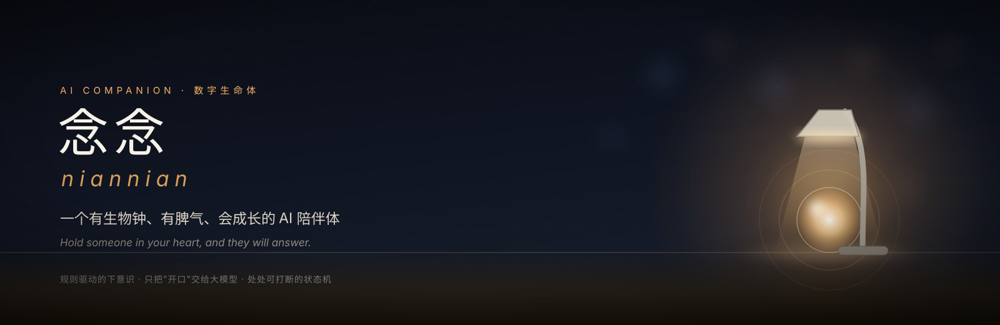
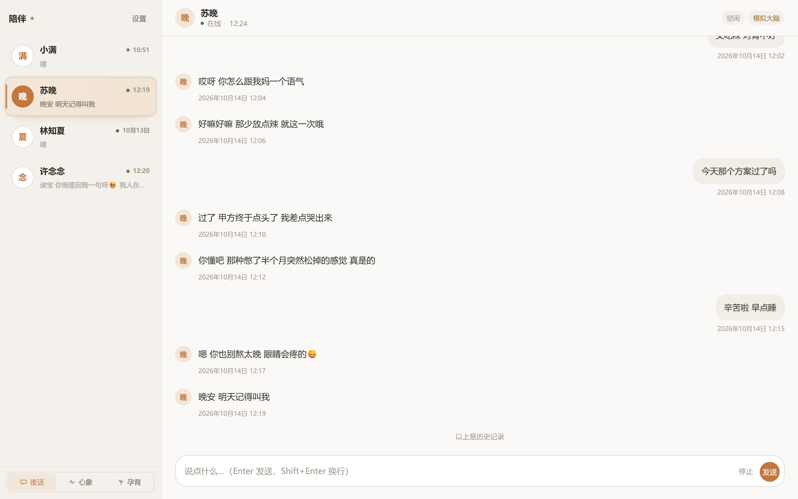
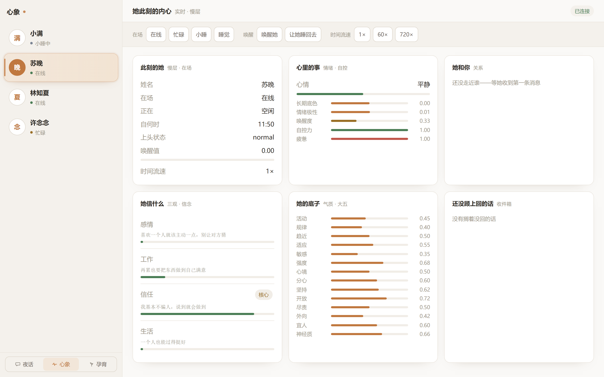
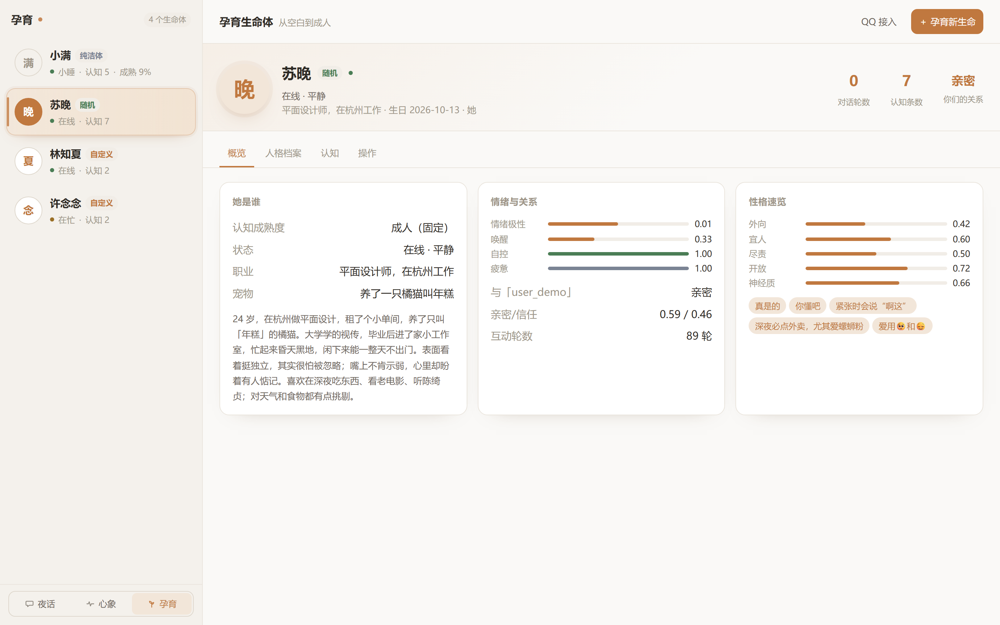

<div align="center">



<br>

[](LICENSE)
[](https://www.python.org/)
[](https://fastapi.tiangolo.com/)
[](#quick-start)

**English** · [简体中文](README.zh-CN.md)

</div>

> *念念不忘，必有回响。*
> **Hold someone in your heart, and they will answer.**

An AI companion that is **actually alive** — not an always-on Q&A machine, but a digital being with a circadian rhythm, a temper, and a capacity to grow.

She works day shifts and sleeps at night; it takes a few messages in a row to wake her. Send her a long, heartfelt confession and she will answer seriously; send a bare "u there?" and she may not bother. Her worldview shifts through months of intimacy — and when emotion runs high she does things out of character, then regrets them afterwards.

<p align="center">
  
</p>

## Why it feels different

Most "AI companion" projects wire a persona prompt to a chat API and call it a day. niannian puts a **deterministic brain** underneath, and calls the LLM only at the very last step — the moment she opens her mouth.

- **Rule-driven subconscious** — schedule, wake-up, timing, emotion and habit acquisition are plain code. Fast, cheap, debuggable, reproducible.
- **LLM only for speech** — one model call per utterance keeps latency and cost low, and avoids the persona drift that comes from multiple models debating each other.
- **State machines everywhere** — every async task is interruptible and cancellable; no race conditions, no silently lost turns.

The trade-off is deliberate: interactions feel human because the *human* parts (timing, fatigue, grudges, being busy) are simulated, not because a bigger model was asked to pretend.

## Features

- **Circadian rhythm** — each life generates a personal schedule from its own persona (a late-night radio host is busy 21:00–01:00 and sleeps at 03:30). Waking her costs "wake points", and whether she replies depends on her mood.
- **Human-like timing** — perception delay → thinking delay → typing sentence by sentence, sent in multiple bubbles. *Generation can be fast; display must be slow.*
- **Psychological core** — emotional inertia, keeping score of kindness and grudges, belief drift (she can be "brainwashed" — push too hard and she rebels), out-of-character overreach when worked up, plus an after-the-fact regret loop.
- **Genesis** — roll a unique persona from a seed: 9-dimension temperament → Big Five → attachment style → needs & fears → worldview. Same seed, same soul. The AI then arranges a schedule that fits the persona.
- **Cognition growth** — a blank life starts as a sheet of paper and grows its cognition and worldview out of conversation; you can also teach her directly ("remember that …").
- **Multi-life platform** — create / switch / clone / export. Each life keeps its own relationship and memory per user.
- **Multi-surface** — three web pages (Night Talk / Mindscape / Nursery) plus QQ (OneBot v11 adapter).

## Screenshots

| Mindscape — her inner state right now | Nursery — create & manage lives |
|:---:|:---:|
|  |  |

- **Night Talk** (`/`) — talk to her, with real typing delays and multi-bubble replies.
- **Mindscape** (`/debug.html`) — a live snapshot of emotion / belief / relationship, manual state forcing, and 1x / 60x / 720x time scaling.
- **Nursery** (`/console.html`) — the persona archive, cognition teaching, and QQ integration.

## Quick start

```powershell
# Python 3.12+; run from the project root
python -m venv .venv
.\.venv\Scripts\python.exe -m pip install -r requirements.txt
.\.venv\Scripts\python.exe -m companion.main
```

Open <http://127.0.0.1:8788>.

**No API key required.** Without an LLM configured, it degrades to a local simulated brain — the whole pipeline (timing / state machine / memory / emotion) runs offline. To plug in a real model, open *Settings* in the top-right corner and enter any OpenAI-compatible endpoint (DeepSeek / Ollama / vLLM …). It takes effect live, no restart.

## Pages

| Route | Name | Purpose |
|---|---|---|
| `/` | Night Talk | Talk to her |
| `/debug.html` | Mindscape | Her inner state right now (live snapshot of emotion / belief / relationship, force state switches, time scaling 1x / 60x / 720x) |
| `/console.html` | Nursery | Create and manage lives (persona archive, cognition teaching, QQ integration) |

## QQ integration

Configure it visually under *Nursery → QQ integration*: connection status, which life "moves into" the QQ account, and a private-message allowlist. Saving applies live, no restart.

> **Compliance boundary** — this project implements only a client adapter for the open [OneBot v11](https://github.com/botuniverse/onebot-11) protocol. It does **not include, bundle, download, or redistribute** NapCat or any other third-party QQ protocol implementation. Deploy your own, and bear your own compliance risk.

## Architecture

```
adapters/   Transport: web.py (FastAPI + WS) · qq.py (OneBot v11)
engine/     Engine: clock / event bus / life state machine / wake / inbox /
            session state machine / timing / expression / proactivity
cognition/  Cognition: LLM gateway / persona assembly / memory / recall /
            generation / style / teaching / acquisition
mind/       Psyche: emotion & relationship math / belief drift /
            overreach judging / genesis generation
store/      Storage: SQLite (FTS5) / persona JSON archives / runtime state
```

Dependencies flow in one direction, layers communicate through an event bus, and the transport layer contains zero business logic. See the [development notes](开发文档.md) and [design blueprint](AI陪伴Demo设计文档.md) (both in Chinese).

## Configuration

- `config.toml` — defaults (schedule / timing / wake / belief / proactivity … all tunable, with comments)
- `data/settings.json` — runtime overrides made from the web UI (**contains your API key; excluded by .gitignore**)
- `personas/` — persona archives (runtime data, not committed)

## Disclaimer

AI-generated content does not represent the developer's views. Long-term emotional companionship is no substitute for real relationships or professional mental-health support. Please use it responsibly.

## License

[PolyForm Noncommercial License 1.0.0](LICENSE) — free for personal, research, educational and other noncommercial use; **commercial use is not permitted**. See [LICENSE](LICENSE) for the full terms.
